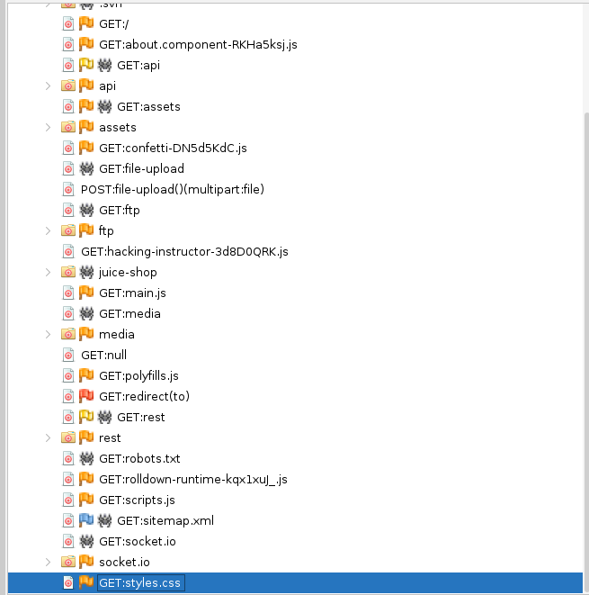
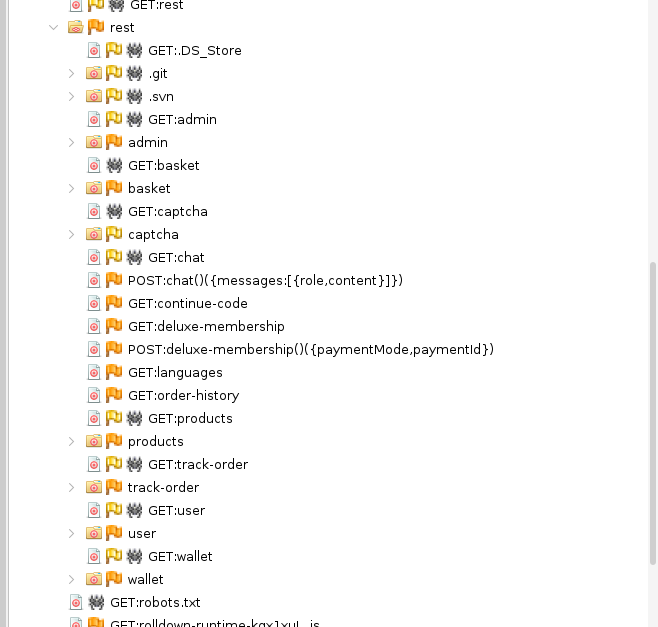
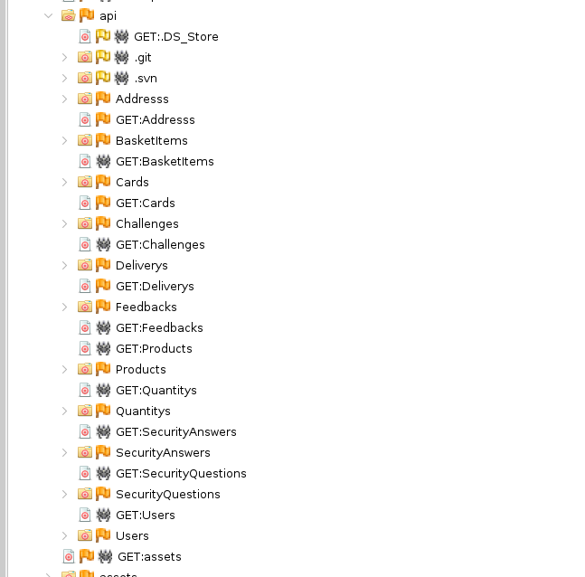
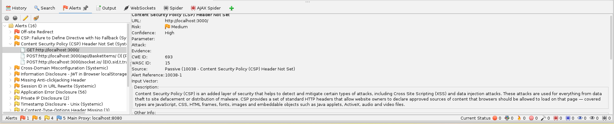
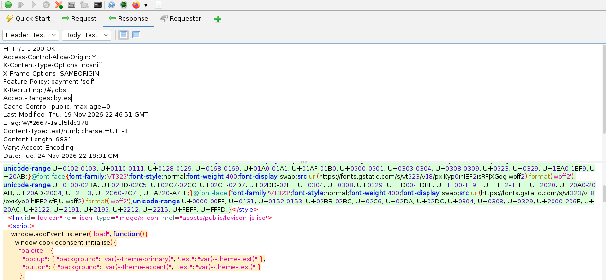
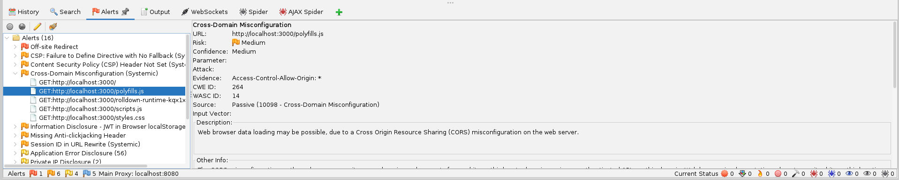
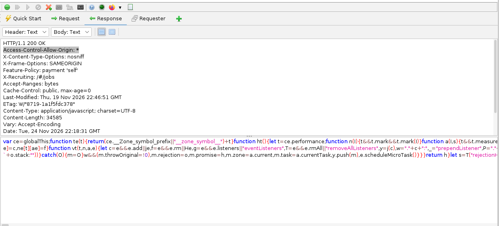
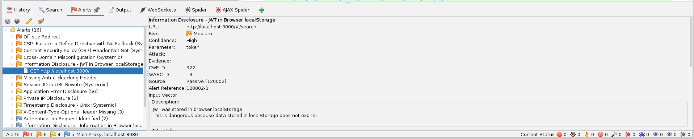
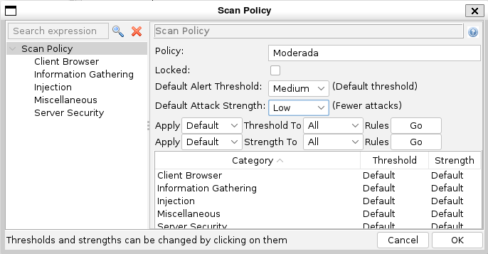
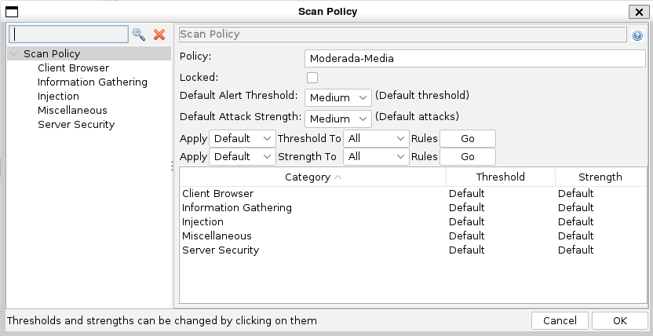

# Informe de Evaluación de Vulnerabilidades Web (Entorno de Laboratorio)

**[Nombre de la Institución]** · **Asignatura:** Temas Selectos de Seguridad de la Información

| Campo | Detalle |
| :---- | :---- |
| **Proyecto / Sistema Evaluado** | OWASP Juice Shop (Instancia Local) |
| **Versión del Documento** | 1.0 |
| **Fecha de Evaluación** | 23–24/11/2026 |
| **Equipo Auditor (Estudiantes)** | _[Nombres y Matrículas]_ |
| **Marco de Referencia** | NIST Cybersecurity Framework (CSF) 2.0 & OWASP Top 10 |

---

## 1. Resumen Ejecutivo y Gobernanza (Función NIST CSF 2.0: *Govern - GV*)

Esta evaluación aplicó un enfoque de **pruebas dinámicas de seguridad (DAST) no invasivas** sobre una instancia local y aislada de **OWASP Juice Shop** (`20.4.0-SNAPSHOT`). Se combinaron tres herramientas complementarias según la metodología de la práctica: **Nuclei** (reconocimiento basado en plantillas), **OWASP ZAP** (proxy de inspección, análisis pasivo y escaneo activo acotado) y **sqlmap** (validación lógica de inyección SQL). En todo momento el objetivo fue **demostrar la existencia** de las vulnerabilidades, no explotarlas: no se extrajeron tablas, no se volcaron credenciales y no se modificó el estado de la base de datos.

**Estado general de la postura de seguridad.** La aplicación —intencionalmente vulnerable por diseño— presenta una **inyección SQL no autenticada** en el flujo de autenticación, confirmada de forma independiente por tres métodos (escaneo activo de ZAP → la propia sentencia SQL que el servidor filtra en sus errores → validación lógica con sqlmap). Alrededor de este hallazgo crítico se observa un patrón sistémico de **configuración insegura** y **divulgación de información**: ausencia generalizada de cabeceras de seguridad (empezando por CSP), una política CORS permisiva (`Access-Control-Allow-Origin: *`), almacenamiento del token de sesión (JWT) en un lugar legible por JavaScript —agravado por un hash de contraseña **MD5 sin sal** transportado dentro del propio token—, exposición del endpoint de métricas `/metrics` y mensajes de error verbosos que revelan la estructura de la base de datos. En conjunto, la superficie evaluada refleja los modos de falla típicos de aplicaciones reales inmaduras en su ciclo de desarrollo seguro.

**Alineación con Gobernanza (GV.RM — Gestión de Riesgos y GV.OV — Supervisión).** Los resultados técnicos de esta evaluación son un insumo directo para la toma de decisiones de la organización:

* **GV.RM (Gestión de Riesgos):** la clasificación por riesgo (Sección 3) permite **priorizar la inversión**: el hallazgo Crítico (VULN-01, inyección SQL) concentra el riesgo y exige remediación inmediata (< 48 h), por encima de los hallazgos de endurecimiento de configuración, que se planifican en ciclos de ≤ 30 días. Esto evita gastar esfuerzo de forma uniforme en debilidades de impacto desigual.
* **GV.OV (Supervisión):** la recurrencia de fallos de configuración (cabeceras, CORS, errores verbosos) indica que el problema no es un defecto aislado sino la **ausencia de controles en el ciclo de desarrollo**. La recomendación de gobernanza es establecer políticas de **codificación segura** (consultas parametrizadas obligatorias, manejo de errores que no filtre detalles internos) y **exigir pruebas DAST automatizadas** como puerta de calidad antes de cada despliegue a producción (ver Sección 6).

**Resumen de Hallazgos por Severidad:**

| Crítica | Alta | Media | Baja | Informativa |
| :----: | :----: | :----: | :----: | :----: |
| **1** | **0** | **6** | **2** | **7** |

> Las cifras corresponden a la **matriz consolidada priorizada** (Sección 4), tras deduplicar entre herramientas y descartar falsos positivos. Reflejan los hallazgos con acción de remediación asociada. El detalle crudo por herramienta se conserva en los anexos: Nuclei reportó **14 coincidencias** (1 falso positivo confirmado, Anexo B.3) y ZAP registró **16 tipos de alerta pasiva / 4 124 instancias** más las alertas activas (Anexo C). Los 7 ítems **Informativos** agrupan detecciones de tecnología y de comportamiento de la aplicación que no constituyen debilidades remediables (p. ej. identificación del framework, de la app como Juice Shop, uso de `localStorage`/`sessionStorage`), listados en los anexos.

## 2. Alcance, Inventario y Metodología (Función NIST CSF 2.0: *Identify - ID*)

### Inventario de Activos Evaluados (ID.AM)

* **Aplicación:** OWASP Juice Shop `20.4.0-SNAPSHOT` (SPA en Angular + backend Node.js/Express + base de datos SQLite `3.44.2`), imagen Docker `bkimminich/juice-shop@sha256:adaf6a6ca50f772dff7d2fe56972c659e81a61e0dbbe607c2b39fefd436e6153`. Motor Node.js `v24.22.3` (observado en `/metrics`).
* **Endpoint objetivo:** `http://127.0.0.1:3000`, también accedido como `http://localhost:3000`. Ambos nombres resuelven a la misma instancia local. Nuclei se ejecutó contra `127.0.0.1` y ZAP contra `localhost`. ZAP los trata como dos sitios distintos, por lo que todo el trabajo en ZAP usa únicamente `localhost:3000`.
* **Fuera de alcance:** cualquier otro host. En ZAP se definió un Contexto que incluye solo `http://localhost:3000.*` (ver Anexo C).

### Metodología Aplicada (ID.RA)

1. Reconocimiento y análisis basado en plantillas (Nuclei): Anexo B.
2. Inspección de tráfico mediante proxy, análisis pasivo y escaneo activo acotado (OWASP ZAP): Anexo C.
3. Validación lógica no invasiva de inyección SQL (sqlmap): Anexo D.

**Control de tráfico aplicado** (detalle en cada anexo):

| Herramienta | Medida |
| :---- | :---- |
| Nuclei | Filtro por etiquetas y severidad (3 021 de 13 806 plantillas); `-rl 10` (≤ 10 peticiones/s); `-c 5` (5 plantillas en paralelo); plantillas `intrusive` y `default-login` excluidas; sin interactsh (`-ni`) |
| ZAP: spiders | Duración máxima de 10 min; AJAX Spider con 2 navegadores |
| ZAP: escaneo activo | Política `Moderada` (umbral Medium, fuerza Low); 2 endpoints sin recursión; retardo de 100 ms por petición; tasa medida ≈ 3.8 y ≈ 7.6 peticiones/s, con un máximo de 2 peticiones simultáneas |
| sqlmap | Solo técnica booleana (`--technique=B`); sin enumeración (`--dump`/`--tables`/`--columns`); solo banner de versión (`--banner`); ejecución por lotes (`--batch`) |

## 3. Modelo de Estimación de Riesgo

El **nivel de riesgo** de cada hallazgo combina la **severidad técnica base** (CVSS v3.1) con dos factores contextuales de la aplicación evaluada:

$$Riesgo = Probabilidad \times Impacto$$

* **Probabilidad de explotación** — facilidad de descubrimiento, disponibilidad pública del vector y ausencia de controles previos.
* **Impacto operativo** — efecto sobre la **confidencialidad, integridad y disponibilidad** (CIA) de los datos y del servicio.

Esta distinción es deliberada: la **severidad CVSS** mide la peligrosidad intrínseca del defecto, mientras que el **riesgo** la ajusta al contexto. Por ejemplo, una severidad base alta con probabilidad baja puede resultar en un riesgo medio; se evita así confundir ambos conceptos.

**Bandas de riesgo y tiempos de remediación sugeridos:**

| Nivel de Riesgo | Rango CVSS Ref. | Criterio de Priorización y Tiempo de Remediación Sugerido |
| :---- | :---- | :---- |
| **Crítico** | 9.0 – 10.0 | Compromiso total de confidencialidad, integridad o disponibilidad; explotación trivial sin autenticación. **Remediación inmediata (< 48 h).** |
| **Alto** | 7.0 – 8.9 | Acceso no autorizado a datos sensibles o ejecución de lógica privilegiada. **Remediación prioritaria (< 7 días).** |
| **Medio** | 4.0 – 6.9 | Exposición parcial de información o debilidades que requieren condiciones específicas para ser explotadas. **Remediación planificada (< 30 días).** |
| **Bajo** | 0.1 – 3.9 | Debilidades de endurecimiento (*hardening*) o faltantes de defensa en profundidad con impacto directo limitado. **Ciclo regular de mantenimiento.** |

**Matriz cualitativa Probabilidad × Impacto** (usada para derivar el *Nivel de Riesgo Final* de cada ficha en la Sección 5):

| Probabilidad \ Impacto | Bajo | Medio | Alto | Crítico |
| :---- | :----: | :----: | :----: | :----: |
| **Alta** | Medio | Medio | Alto | **Crítico** |
| **Media** | Bajo | Medio | Alto | Alto |
| **Baja** | Bajo | Bajo | Medio | Alto |

## 4. Matriz Consolidada de Hallazgos y Mapeo a NIST CSF 2.0

| ID | Título del Hallazgo | Herramienta | Clasificación (OWASP / CWE) | CVSS / Riesgo Estimado | Función y Categoría NIST CSF 2.0 Impactada |
| :---- | :---- | :---- | :---- | :---- | :---- |
| **VULN-01** | Inyección SQL no autenticada (login y búsqueda) | OWASP ZAP / sqlmap | A03:2021 / CWE-89 | **9.8 (Crítico)** | **Protect (PR.PS)**: Seguridad de Plataformas y Desarrollo Seguro |
| **VULN-02** | Ausencia/aplicación inconsistente de cabeceras de seguridad HTTP (CSP, HSTS, etc.) | Nuclei / ZAP | A05:2021 / CWE-693 | **4.3 (Medio)** | **Protect (PR.PS / PR.IR)**: Configuración Segura y Resiliencia |
| **VULN-03** | Configuración CORS permisiva (`Access-Control-Allow-Origin: *`) | OWASP ZAP | A05:2021 / CWE-942 | **5.3 (Medio)** | **Protect (PR.PS)** / **Identify (ID.RA)**: Configuración Segura |
| **VULN-04** | Almacenamiento inseguro del JWT + hash de contraseña MD5 sin sal | OWASP ZAP | A02:2021 / CWE-922 (+ CWE-916) | **6.5 (Medio)** | **Protect (PR.DS)**: Protección de Datos |
| **VULN-05** | Exposición del endpoint de métricas `/metrics` (Prometheus) | Nuclei | A05:2021 / CWE-200 | **5.3 (Medio)** | **Identify (ID.AM)** / **Protect (PR.DS)**: Gestión de Activos y Protección de Datos |
| **VULN-06** | Divulgación de errores verbosos y de la sentencia SQL | OWASP ZAP | A05:2021 / CWE-209 | **5.3 (Medio)** | **Protect (PR.PS)** / **Detect (DE.CM)**: Desarrollo Seguro y Monitoreo |
| **VULN-07** | Redirección fuera de sitio (*Off-site Redirect*) | OWASP ZAP | A01:2021 / CWE-601 | **4.3 (Medio)** | **Protect (PR.PS)**: Validación de Entrada |

> La inyección SQL (VULN-01) se documenta como **una sola vulnerabilidad de raíz** (concatenación de entrada no saneada en sentencias SQL) que se manifiesta en dos endpoints con forma de consulta distinta: `POST /rest/user/login` (parámetro `email`) y `GET /rest/products/search` (parámetro `q`). Es el hallazgo líder por estar confirmado por tres métodos independientes.

## 5. Ficha Técnica Detallada de Vulnerabilidades

### VULN-01 — Inyección SQL no autenticada (login y búsqueda)

* **Componente / Endpoint Afectado:** `POST /rest/user/login` (parámetro `email`, cuerpo JSON) y `GET /rest/products/search` (parámetro `q`).
* **Herramienta(s) de Detección:** OWASP ZAP (escaneo activo, regla 40018) y sqlmap (validación lógica). Corroborado además por los mensajes de error de la propia aplicación.
* **Estimación del Riesgo:**
  * **Vector CVSS:** `CVSS:3.1/AV:N/AC:L/PR:N/UI:N/S:U/C:H/I:H/A:H` → **9.8**.
  * **Probabilidad: Alta** — el vector es accesible sin autenticación, se descubre con un solo carácter (`'`) y la propia aplicación confirma el fallo devolviendo la sentencia SQL en su mensaje de error. No existe ningún control de entrada previo.
  * **Impacto: Crítico** — una inyección SQL en el flujo de autenticación permite, de explotarse, el **bypass de autenticación** y el acceso de lectura/escritura a la base de datos completa (usuarios, credenciales, pedidos), comprometiendo confidencialidad e integridad.
  * **Nivel de Riesgo Final:** **Crítico.**
* **Descripción Técnica y Evidencia No Invasiva:**
  La aplicación construye sus consultas SQL **concatenando directamente** la entrada del usuario, sin parametrización. El servidor lo evidencia por sí mismo en sus respuestas `500`:
  * **Login** — enviar `email` con una sola comilla produce `HTTP/1.1 500 Internal Server Error` con `SQLITE_ERROR: unrecognized token`. El cuerpo filtra la consulta: `SELECT * FROM Users WHERE email = ''' AND password = '…' AND deletedAt IS NULL`. La comilla queda sin cerrar porque `email` se inserta **una sola vez** dentro de un literal entre comillas simples.
  * **Búsqueda** — el parámetro `q` se inserta **dos veces** (`name LIKE` y `description LIKE`), por lo que una comilla sola se re-empareja y la consulta permanece válida; el ataque `'(` sí rompe la sintaxis y devuelve `500` con `SQLITE_ERROR: near "(": syntax error` y la sentencia `SELECT * FROM Products WHERE ((name LIKE '%'(%' OR description LIKE '%'(%') AND deletedAt IS NULL) ORDER BY name`.
  * **Confirmación no invasiva (sqlmap, Anexo D)** — sobre `POST /rest/user/login`, parámetro `email`, sqlmap confirmó una inyección **boolean-based blind** (variante *OR … NOT*), identificó el motor **SQLite 3.44.2** y leyó únicamente el banner de versión, en 115 peticiones. **No se extrajo ningún dato** (`--technique=B`, sin `--dump`/`--tables`/`--columns`). La prueba se detuvo en la confirmación de la condición lógica, cumpliendo la regla de mínima invasividad.
  * Evidencia: alertas ZAP en `zap_snapshot/active_scan_alerts_2026-11-24_localhost.json` y `…search_medium_alerts…json`; consola de sqlmap en `sqlmap_out/sqlmap_console_login_2026-11-24.txt`.
* **Recomendación de Remediación:**
  Usar **consultas parametrizadas / *prepared statements*** en todas las interacciones con la base de datos (p. ej., a través del ORM Sequelize con *bind parameters*, nunca interpolación de cadenas). Validar y normalizar la entrada con esquemas estrictos. Aplicar el principio de **mínimo privilegio** al usuario de la base de datos. Como defensa en profundidad, silenciar los mensajes de error detallados hacia el cliente (ver VULN-06).

### VULN-02 — Ausencia/aplicación inconsistente de cabeceras de seguridad HTTP

* **Componente / Endpoint Afectado:** todas las respuestas del servidor (ej. `GET /`).
* **Herramienta(s) de Detección:** Nuclei (`http-missing-security-headers`, 8 variantes; `deprecated-feature-policy`) y ZAP (alertas 10038, 10055, 10020, 10021).
* **Estimación del Riesgo:**
  * **Vector CVSS:** `CVSS:3.1/AV:N/AC:L/PR:N/UI:R/S:U/C:L/I:N/A:N` → **4.3**.
  * **Probabilidad: Media** — trivial de descubrir, pero el impacto solo se materializa en combinación con otro vector (p. ej. XSS o *clickjacking*).
  * **Impacto: Bajo** — se trata de defensa en profundidad; su ausencia no compromete datos por sí sola, pero amplifica otras vulnerabilidades.
  * **Nivel de Riesgo Final:** **Medio.**
* **Descripción Técnica y Evidencia No Invasiva:**
  Las respuestas **no incluyen** `Content-Security-Policy`, `Permissions-Policy`, `Referrer-Policy`, `Strict-Transport-Security` ni las políticas *Cross-Origin* (COEP/COOP/CORP). Sin CSP, un script inyectado (vía XSS) se ejecuta sin restricción de origen; ZAP marca la alerta como *Systemic* (1 333 instancias). Además se observa una aplicación **inconsistente**: la página principal sí envía `X-Content-Type-Options: nosniff` y `X-Frame-Options: SAMEORIGIN`, pero ZAP detecta respuestas puntuales sin `X-Content-Type-Options` (3) y sin cabecera anti-*clickjacking* (1), y una CSP parcial en alguna ruta (`CSP: Failure to Define Directive with No Fallback`, 9). El servidor también envía la cabecera **obsoleta** `Feature-Policy: payment 'self'` en lugar de `Permissions-Policy`.
  * Evidencia: `m2_passive_csp_alert.png`, `m2_passive_csp_response_headers.png`; Anexo B.3 (N-02…N-09, N-13).
* **Recomendación de Remediación:**
  Aplicar un middleware de cabeceras (p. ej. `helmet` en Express) de forma **global y uniforme**: definir una `Content-Security-Policy` restrictiva, migrar `Feature-Policy` → `Permissions-Policy`, y añadir `Referrer-Policy` y las políticas *Cross-Origin*. `Strict-Transport-Security` aplica únicamente al servir sobre HTTPS.

### VULN-03 — Configuración CORS permisiva (`Access-Control-Allow-Origin: *`)

* **Componente / Endpoint Afectado:** todas las respuestas (ej. `GET /polyfills.js`, `GET /rest/products/search`).
* **Herramienta(s) de Detección:** ZAP (*Cross-Domain Misconfiguration*, 10098; 1 449 instancias).
* **Estimación del Riesgo:**
  * **Vector CVSS:** `CVSS:3.1/AV:N/AC:L/PR:N/UI:N/S:U/C:L/I:N/A:N` → **5.3**.
  * **Probabilidad: Media** — configuración visible en cada respuesta; su aprovechamiento se limita a lo accesible sin autenticación.
  * **Impacto: Bajo** — con el comodín `*`, el navegador **no** adjunta credenciales, y el token de Juice Shop viaja en `Authorization: Bearer` (no legible por sitios externos). Solo queda expuesta la información pública (catálogo, búsquedas, `/api-docs`, `/metrics`).
  * **Nivel de Riesgo Final:** **Medio.**
* **Descripción Técnica y Evidencia No Invasiva:**
  El servidor responde con `Access-Control-Allow-Origin: *`, autorizando a JavaScript de **cualquier** origen a **leer** sus respuestas en el navegador de un usuario. CORS no controla quién puede *enviar* peticiones (eso es siempre posible con cualquier cliente HTTP), sino qué orígenes pueden *leer* la respuesta. El comodín es incompatible con el envío de credenciales, lo que acota el impacto a datos no autenticados.
  * Evidencia: `m2_passive_cors_alert.png`, `m2_passive_cors_response_headers.png`.
* **Recomendación de Remediación:**
  Sustituir el comodín por una **lista explícita de orígenes de confianza** y devolver el encabezado CORS solo para esos orígenes. Evitar reflejar el `Origin` recibido sin validación.

### VULN-04 — Almacenamiento inseguro del JWT + hash de contraseña MD5 sin sal

* **Componente / Endpoint Afectado:** `POST /rest/user/login` → almacenamiento del navegador (`localStorage`/cookie `token`) en el origen `localhost:3000`.
* **Herramienta(s) de Detección:** ZAP (*Information Disclosure - JWT in Browser localStorage*, 120002).
* **Estimación del Riesgo:**
  * **Vector CVSS:** `CVSS:3.1/AV:N/AC:L/PR:N/UI:R/S:U/C:H/I:N/A:N` → **6.5**.
  * **Probabilidad: Media** — requiere un vector adicional (XSS) para leer el almacenamiento; Juice Shop contiene varios XSS, por lo que la precondición es realista.
  * **Impacto: Alto** — el robo del token permite **suplantar la sesión**; además, como el JWT transporta el hash de la contraseña, se filtra también la credencial.
  * **Nivel de Riesgo Final:** **Medio** (elevable a Alto en presencia de un XSS explotable).
* **Descripción Técnica y Evidencia No Invasiva:**
  El servidor entrega el JWT en el **cuerpo JSON** de la respuesta de login y **nunca** lo establece con `Set-Cookie`; por ello no puede marcarlo `HttpOnly`, `Secure` ni `SameSite`. El JavaScript de la página guarda el token en `localStorage` y crea una cookie `token` desde el propio script, ambos legibles por cualquier script del origen. Un XSS en la aplicación permitiría robar el token. **Agravante (CWE-916):** la parte central del JWT es solo Base64 (no cifrada) y contiene un campo `password` con el **hash MD5 sin sal** de la contraseña del usuario; un MD5 sin sal de una contraseña común se revierte por tablas de consulta. Así, robar el token expone también la contraseña.
  * Evidencia: `m2_passive_jwt_localstorage_alert.png`; respuesta de login (mensaje #70, token omitido) en Anexo C.3. *Nota de manejo de datos: los tokens reales fueron depurados de todas las evidencias publicadas y no se incluye texto plano de contraseñas de cuentas sembradas.*
* **Recomendación de Remediación:**
  Emitir el token como **cookie `HttpOnly` + `Secure` + `SameSite`** para sustraerlo del alcance de JavaScript. **No** incluir el hash de la contraseña (ni ningún dato sensible) en el JWT. Reemplazar MD5 por un algoritmo de *hashing* lento y **con sal** (bcrypt/scrypt/Argon2) en el almacenamiento de credenciales.

### VULN-05 — Exposición del endpoint de métricas `/metrics` (Prometheus)

* **Componente / Endpoint Afectado:** `GET /metrics` (sin autenticación).
* **Herramienta(s) de Detección:** Nuclei (`prometheus-metrics`, medium).
* **Estimación del Riesgo:**
  * **Vector CVSS:** `CVSS:3.1/AV:N/AC:L/PR:N/UI:N/S:U/C:L/I:N/A:N` → **5.3**.
  * **Probabilidad: Alta** — endpoint público, fijo y trivial de localizar.
  * **Impacto: Bajo** — divulga información operativa, no credenciales.
  * **Nivel de Riesgo Final:** **Medio.**
* **Descripción Técnica y Evidencia No Invasiva:**
  El endpoint devuelve una exposición Prometheus legítima (`Content-Type: text/plain; version=0.0.4`) con **51 familias de métricas**, entre ellas la **versión exacta** de la aplicación (`juiceshop_version_info 20.4.0-SNAPSHOT`) y de Node.js (`v24.22.3`), conteos de usuarios registrados, pedidos, saldo de monederos y progreso de retos, además de métricas internas del proceso. Esta información facilita la enumeración y el *fingerprinting* a un atacante. Se confirmó que es contenido real (no la página SPA de respaldo que Juice Shop devuelve ante rutas desconocidas).
  * Evidencia: Anexo B.3 (N-10).
* **Recomendación de Remediación:**
  **Restringir** `/metrics` a redes internas o detrás de autenticación (p. ej., *scraping* solo desde la red de monitoreo), nunca expuesto a clientes no autenticados.

### VULN-06 — Divulgación de errores verbosos y de la sentencia SQL

* **Componente / Endpoint Afectado:** respuestas de error `500` de los endpoints que interactúan con la base de datos.
* **Herramienta(s) de Detección:** ZAP (*Application Error Disclosure*, 90022; 56 instancias) y observación directa durante el escaneo activo.
* **Estimación del Riesgo:**
  * **Vector CVSS:** `CVSS:3.1/AV:N/AC:L/PR:N/UI:N/S:U/C:L/I:N/A:N` → **5.3**.
  * **Probabilidad: Alta** — cualquier entrada anómala dispara el error; no requiere condiciones especiales.
  * **Impacto: Bajo/Medio** — no expone datos de usuario directamente, pero revela la estructura interna (tablas, columnas, rutas de archivos, *stack traces*), lo que **acelera** la explotación de VULN-01.
  * **Nivel de Riesgo Final:** **Medio.**
* **Descripción Técnica y Evidencia No Invasiva:**
  Ante entradas malformadas, el servidor responde con un JSON que incluye `message`, `stack`, `sql` y rutas internas (`/juice-shop/node_modules/sequelize/…`). La filtración de la **sentencia SQL completa** con nombres de tabla y columna es lo que convierte la inyección de VULN-01 en un objetivo fácil. Este hallazgo está directamente ligado a VULN-01 y a VULN-05.
  * Evidencia: sentencias filtradas citadas en VULN-01 y en el Anexo C.4.
* **Recomendación de Remediación:**
  Implementar un **manejador de errores global** que devuelva mensajes genéricos al cliente (`500 Internal Server Error` sin detalle) y registre el detalle solo en los *logs* del servidor. Deshabilitar *stack traces* en producción.

### VULN-07 — Redirección fuera de sitio (*Off-site Redirect*)

* **Componente / Endpoint Afectado:** parámetro de redirección observado por ZAP (1 instancia).
* **Herramienta(s) de Detección:** ZAP (*Off-site Redirect*, 10028).
* **Estimación del Riesgo:**
  * **Vector CVSS:** `CVSS:3.1/AV:N/AC:L/PR:N/UI:R/S:U/C:N/I:L/A:N` → **4.3**.
  * **Probabilidad: Media** — depende de que la víctima siga un enlace manipulado.
  * **Impacto: Bajo/Medio** — habilita *phishing* y abuso de confianza del dominio, sin compromiso directo de datos.
  * **Nivel de Riesgo Final:** **Medio.**
* **Descripción Técnica y Evidencia No Invasiva:**
  ZAP detectó, en una respuesta, una redirección hacia un dominio externo controlable por la entrada. Una redirección abierta permite construir URLs que aparentan pertenecer al sitio pero envían al usuario a un destino arbitrario. *ZAP etiquetó la única instancia como High; se reevalúa a riesgo Medio por requerir interacción del usuario y no afectar la confidencialidad.* La confirmación del parámetro exacto y la verificación del *bypass* de lista de permitidos quedan fuera del alcance no invasivo de este informe.
  * Evidencia: `zap_snapshot/passive_alerts_2026-11-24_localhost.json` (regla 10028).
* **Recomendación de Remediación:**
  Validar los destinos de redirección contra una **lista de permitidos** de rutas/orígenes internos; evitar redirigir a URLs completas provenientes de la entrada del usuario.

## 6. Plan de Remediación y Mejora Continua (NIST CSF 2.0)

| Función NIST CSF 2.0 | Categoría Relacionada | Acción de Mejora Propuesta para el Entorno Evaluado |
| :---- | :---- | :---- |
| **Govern (GV)** | GV.SC / GV.RM | Establecer estándares internos de **codificación segura** (prohibir la concatenación de SQL; exigir consultas parametrizadas) y **exigir pruebas DAST automatizadas** (Nuclei + ZAP en el *pipeline*) como puerta de calidad antes de cada despliegue. Priorizar presupuesto según la matriz de riesgo (Sección 3): VULN-01 primero. |
| **Identify (ID)** | ID.RA-01 / ID.AM | Mantener un **inventario actualizado de endpoints API** (incluyendo `/metrics`, `/api-docs`) y ejecutar escaneos periódicos con plantillas de Nuclei actualizadas. Clasificar qué endpoints deben ser públicos (VULN-05). |
| **Protect (PR)** | PR.PS-01 / PR.DS | Implementar **consultas parametrizadas** (VULN-01); **endurecer cabeceras HTTP** de forma uniforme con `helmet` (VULN-02, VULN-03); emitir el token como cookie `HttpOnly`/`Secure`/`SameSite` y sustituir MD5 por bcrypt/Argon2 con sal (VULN-04); restringir `/metrics` (VULN-05); sanear mensajes de error (VULN-06); validar redirecciones (VULN-07). Aplicar **mínimo privilegio** al usuario de BD. |
| **Detect (DE)** | DE.CM-09 | Configurar **registros centralizados** y alertas (WAF/SIEM) ante patrones anómalos: picos de errores `HTTP 500`, caracteres de inyección (`'`, `(`, `--`) en parámetros, y tasas elevadas de peticiones. Los `500/SQLITE_ERROR` de VULN-06 son precisamente la señal a monitorear. |
| **Respond (RS)** | RS.MA / RS.MI | Definir un procedimiento de **contención rápida**: reglas de bloqueo en WAF o deshabilitación temporal del endpoint vulnerable (`/rest/user/login`) ante una alerta activa de inyección, mientras se despliega el parche. |
| **Recover (RC)** | RC.RP-01 | Verificar la **integridad de las copias de seguridad** de la base de datos y validar el restablecimiento limpio tras aplicar los parches, confirmando que la corrección (consultas parametrizadas) persiste en el despliegue restaurado. |

---

# Anexos: Evidencia Técnica por Módulo

## Anexo A. Preparación del Entorno

* Docker Engine `29.6.2`.
* Imagen: `docker pull bkimminich/juice-shop` → `sha256:adaf6a6c…6153`.
* Ejecución indicada por la guía: `docker run --rm -p 127.0.0.1:3000:3000 bkimminich/juice-shop` → `info: Server listening on port 3000`.
* Herramientas instaladas mediante el `flake.nix` del repositorio (entorno reproducible con Nix + direnv; equivale a `apt install`): `nuclei`, `zap`, `firefox`, `geckodriver` y `sqlmap`.

> **Nota de alcance:** el contenedor activo durante los Módulos 1 y 2 estaba publicado en `0.0.0.0:3000` y `[::]:3000` (todas las interfaces), no solo en `127.0.0.1`. Se relanzó con el comando de la guía. `docker ps` muestra ahora `127.0.0.1:3000->3000/tcp`, y las pruebas siguientes (repetición del escaneo activo de la búsqueda y Módulo 3) se realizan con esta configuración.

## Anexo B. Módulo 1: Nuclei

### B.1 Instalación y plantillas

* Nuclei `v3.11.1` (paquete `nuclei` de nixpkgs).
* Actualización del repositorio de plantillas:

```
$ nuclei -update-templates
[INF] nuclei-templates are not installed, installing...
[INF] Successfully installed nuclei-templates at /home/nixos/nuclei-templates
[INF] No new updates found for nuclei templates
```

* Al ejecutar el escaneo: `Current nuclei version: v3.11.1 (latest)` y `Current nuclei-templates version: v10.5.2 (latest)`.

### B.2 Configuración y ejecución

Escaneo ejecutado el **2026-11-23** (≈ 09:30–09:38, UTC−6):

```bash
nuclei -u http://127.0.0.1:3000 -pt http \
  -tags exposure,misconfig,headers,tech \
  -etags intrusive,default-login \
  -s info,low,medium,high \
  -ni -rl 10 -c 5 \
  -jle nuclei_juice.jsonl -me nuclei_md
```

| Opción | Propósito |
| :---- | :---- |
| `-u http://127.0.0.1:3000` | Único objetivo: la instancia local |
| `-pt http` | Solo plantillas del protocolo HTTP (aplicación web) |
| `-tags exposure,misconfig,headers,tech` | Categorías relevantes: exposiciones, configuraciones erróneas, cabeceras de seguridad y tecnologías detectadas |
| `-etags intrusive,default-login` | Excluye plantillas que modifican el servidor o prueban credenciales por defecto |
| `-s info,low,medium,high` | Severidades; `info` es necesaria porque la ausencia de cabeceras se reporta como `info` |
| `-ni` | Desactiva interactsh (evita peticiones de retorno hacia servidores externos) |
| `-rl 10 -c 5` | Limita a 10 peticiones/s y 5 plantillas concurrentes |
| `-jle` / `-me` | Exporta la evidencia en JSONL y Markdown (incluye la petición y la respuesta HTTP de cada hallazgo) |

Resultado: 3 021 plantillas cargadas, escaneo de 9 min, **14 coincidencias**. Evidencia: [`nuclei_juice.jsonl`](nuclei_juice.jsonl) y [`nuclei_md/`](nuclei_md/index.md).

### B.3 Hallazgos y validación (real / falso positivo)

Criterio de validación: Juice Shop responde `200` con su página principal (SPA) ante cualquier ruta desconocida, por lo que una coincidencia de "exposición" se considera sospechosa hasta que la respuesta muestra **contenido real** (tipo de contenido y cuerpo propios del recurso, no la SPA de respaldo).

| # | Plantilla | Severidad | URL | Clasificación | Justificación |
| :-- | :---- | :---- | :---- | :---- | :---- |
| N-01 | `swagger-api` | info | `/api-docs/swagger.json` | **Real** (exposición) | Devuelve la UI real de Swagger (`text/html` con marcado propio de Swagger UI), no la SPA de respaldo. La documentación de la API es accesible públicamente. Relacionado con VULN-05 (superficie de ataque). |
| N-02 | `http-missing-security-headers:content-security-policy` | info | `/` | **Real** | `GET /` no incluye `Content-Security-Policy`. Corroborado por ZAP (10038). → VULN-02 |
| N-03 | `http-missing-security-headers:permissions-policy` | info | `/` | **Real** | No existe `Permissions-Policy` (solo la obsoleta `Feature-Policy`). → VULN-02 |
| N-04 | `http-missing-security-headers:x-permitted-cross-domain-policies` | info | `/` | **Real** (endurecimiento, relevancia baja) | Cabecera ausente; aplica sobre todo a políticas cross-domain de Flash/PDF, hoy marginal. → VULN-02 |
| N-05 | `http-missing-security-headers:referrer-policy` | info | `/` | **Real** | Sin `Referrer-Policy`; el navegador puede filtrar la URL completa en `Referer`. → VULN-02 |
| N-06 | `http-missing-security-headers:cross-origin-embedder-policy` | info | `/` | **Real** (endurecimiento) | Sin `Cross-Origin-Embedder-Policy`. Defensa en profundidad. → VULN-02 |
| N-07 | `http-missing-security-headers:cross-origin-opener-policy` | info | `/` | **Real** (endurecimiento) | Sin `Cross-Origin-Opener-Policy`. → VULN-02 |
| N-08 | `http-missing-security-headers:cross-origin-resource-policy` | info | `/` | **Real** (endurecimiento) | Sin `Cross-Origin-Resource-Policy`. → VULN-02 |
| N-09 | `http-missing-security-headers:strict-transport-security` | info | `/` | **Real, pero sin efecto aquí** | Cabecera ausente; HSTS solo aplica sobre HTTPS y este despliegue es HTTP, por lo que no tiene efecto práctico en el laboratorio. → VULN-02 (anotado) |
| N-10 | `prometheus-metrics` | medium | `/metrics` | **Real** | Exposición Prometheus legítima (`text/plain; version=0.0.4`) con 51 familias de métricas, incluidas versión de la app/Node.js y conteos de usuarios, pedidos y monederos. → VULN-05 |
| N-11 | `fingerprinthub-web-fingerprints:qm-system` | info | `/` | **Falso positivo** | La regla se activa con `src="polyfills.js"`, presente en cualquier aplicación Angular; Juice Shop no es el producto QM System. |
| N-12 | `tech-detect:google-font-api` | info | `/` | **Real** (informativo) | La página principal hace *preconnect* y carga fuentes de `fonts.googleapis.com` / `fonts.gstatic.com`. Detección de tecnología correcta, no es una debilidad. |
| N-13 | `deprecated-feature-policy` | info | `/` | **Real** (informativo/endurecimiento) | La respuesta incluye `Feature-Policy: payment 'self'`, cabecera obsoleta sustituida por `Permissions-Policy`. Relacionado con VULN-02. |
| N-14 | `owasp-juice-shop-detect` | info | `/` | **Real** (informativo) | Identifica correctamente la aplicación como OWASP Juice Shop. No es una debilidad; confirma la identidad del activo (ID.AM). |

**Síntesis Módulo 1:** de 14 coincidencias, **1 es falso positivo** (N-11) y **13 son detecciones correctas**. De estas, las remediables alimentan VULN-02 (cabeceras) y VULN-05 (`/metrics`, con N-01 como exposición relacionada); N-12, N-13 y N-14 son informativas (detección de tecnología/activo).

## Anexo C. Módulo 2: OWASP ZAP

### C.1 Instalación

OWASP ZAP `2.17.0` (paquete `zap` de nixpkgs; `zaproxy` es el nombre en Debian/Kali), junto con `firefox` y `geckodriver` para los componentes que usan un navegador. La sesión de ZAP se guardó en disco (`~/.ZAP/sessions/20261124-161703.session`), y los datos se exportaron al repositorio (C.6).

### C.2 Fase 1: Reconocimiento (exploración manual y spidering)

**Proxy.** Se usó *Quick Start → Manual Explore* de ZAP, que abre Firefox ya configurado para enrutar el tráfico por el proxy local de ZAP (`localhost:8080`).

**Exploración manual** de las funciones principales (peticiones registradas por ZAP):

| Función | Petición observada | Respuesta |
| :---- | :---- | :---- |
| Registro | `POST /api/Users/` (+ `POST /api/SecurityAnswers/`) | `201 Created` |
| Inicio de sesión | `POST /rest/user/login` | `200 OK` |
| Búsqueda de productos | `GET /rest/products/search?q=` | `200 OK` |
| Carrito | `POST /api/BasketItems/`, `PUT /api/BasketItems/10` | `200 OK` |
| Checkout (adicional) | `POST /api/Addresss/`, `POST /api/Cards/`, `POST /rest/basket/6/checkout` | `201` / `200` |

**Contexto.** `Default Context` con la expresión de inclusión `http://localhost:3000.*` (exportado en [`zap_snapshot/default_context.context`](zap_snapshot/default_context.context)).

**Spider tradicional.** Iniciado desde `http://localhost:3000` con *Recurse*, *Spider Subtree Only* y una duración máxima de 10 min. Terminó al 100 %: **1 409 URLs dentro del alcance**, 138 fuera del alcance (listadas, no visitadas) y 1 error de E/S.

**AJAX Spider.** Firefox headless, **2 ventanas de navegador**, duración máxima de 10 min, *Just In Scope*. Se ejecutó de 16:28:57 a 16:32:11 (hora local, UTC−6) y se detuvo solo al agotar los elementos por explorar. No agregó resultados propios: en Juice Shop las vistas internas viven después del `#` (`/#/login`, `/#/basket`) y no generan peticiones HTTP nuevas. El mapa proviene principalmente de la exploración manual y del spider tradicional.

**Incidencias.** Un primer intento del AJAX Spider con 12 ventanas (valor por defecto, una por núcleo) abortó porque un navegador no arrancó a tiempo (`TimeoutException`). Con 2 ventanas se completó sin errores.

**Mapa del sitio (Site Tree).** Al cierre de la exploración, ZAP registraba 2 160 mensajes y 1 966 URLs en `http://localhost:3000` (lista completa en [`zap_snapshot/site_tree_urls_2026-11-24_localhost.txt`](zap_snapshot/site_tree_urls_2026-11-24_localhost.txt)).







> Los nodos `.git`, `.svn` y `.DS_Store` que aparecen bajo `/rest` y `/api` corresponden a sondas automáticas del Spider. El servidor responde `500` a todas ellas, sin contenido de archivo, por lo que no constituyen hallazgos.

### C.3 Fase 2: Análisis de alertas pasivas

Alertas generadas únicamente por la inspección del tráfico legítimo (navegación y spiders), antes del escaneo activo: **16 tipos, 4 124 instancias**.

| Riesgo | Alerta (ID de regla) | CWE | Instancias |
| :---- | :---- | :---- | ----: |
| High | Off-site Redirect (10028) | 601 | 1 |
| Medium | Cross-Domain Misconfiguration (10098) | 264 | 1 449 |
| Medium | Content Security Policy (CSP) Header Not Set (10038) | 693 | 1 333 |
| Medium | Session ID in URL Rewrite (3) | 598 | 24 |
| Medium | CSP: Failure to Define Directive with No Fallback (10055) | 693 | 9 |
| Medium | Information Disclosure - JWT in Browser localStorage (120002) | 922 | 2 |
| Medium | Missing Anti-clickjacking Header (10020) | 1021 | 1 |
| Low | Application Error Disclosure (90022) | 550 | 56 |
| Low | Timestamp Disclosure - Unix (10096) | 497 | 6 |
| Low | X-Content-Type-Options Header Missing (10021) | 693 | 3 |
| Low | Private IP Disclosure (2) | 497 | 2 |
| Informational | Modern Web Application (10109) | - | 1 222 |
| Informational | Information Disclosure - Information in Browser sessionStorage (120000) | 359 | 6 |
| Informational | Session Management Response Identified (10112) | - | 5 |
| Informational | Information Disclosure - Information in Browser localStorage (120000) | 359 | 3 |
| Informational | Authentication Request Identified (10111) | - | 2 |

Se seleccionaron tres alertas que cubren los aspectos que pide la guía: CSP, CORS y cookies/sesión.

#### P1. Content Security Policy (CSP) Header Not Set (10038, Medium, CWE-693)





**Causa raíz a nivel HTTP.** Ninguna respuesta del servidor incluye la cabecera `Content-Security-Policy`, por eso ZAP marca la alerta como *Systemic*. CSP es una cabecera de respuesta HTTP que indica al navegador de qué orígenes puede cargar scripts, estilos, imágenes o marcos. Sin ella, cualquier script inyectado (por ejemplo, mediante XSS) se ejecuta sin restricción. La aplicación sí envía otras cabeceras de seguridad (`X-Content-Type-Options`, `X-Frame-Options`), lo que muestra que la omisión es de configuración del servidor. En Express suele resolverse con un middleware (por ejemplo, `helmet.contentSecurityPolicy`).

#### P2. Cross-Domain Misconfiguration (10098, Medium, CWE-264)





**Causa raíz a nivel HTTP.** Todas las respuestas incluyen `Access-Control-Allow-Origin: *`, es decir, el servidor autoriza a JavaScript de **cualquier** sitio web a leer sus respuestas desde el navegador de un usuario. CORS no controla quién puede *enviar* peticiones (eso siempre es posible con cualquier cliente HTTP), sino qué orígenes pueden *leer* la respuesta en el navegador. Con el comodín `*`, el navegador no permite leer la respuesta de una petición enviada con credenciales (cookies). Además, el token de sesión de Juice Shop viaja en una cabecera `Authorization: Bearer` que un sitio externo no puede leer. El impacto se limita a la información accesible sin autenticación (catálogo, búsquedas, `/api-docs`, `/metrics`), lo que concuerda con la confianza Medium de ZAP. Debería sustituirse por una lista explícita de orígenes de confianza.

#### P3. Information Disclosure - JWT in Browser localStorage (120002, Medium, CWE-922)



Evidencia HTTP: respuesta al inicio de sesión (mensaje #70 del historial de ZAP; token omitido):

```http
POST /rest/user/login HTTP/1.1

HTTP/1.1 200 OK
Access-Control-Allow-Origin: *
X-Content-Type-Options: nosniff
X-Frame-Options: SAMEORIGIN
Feature-Policy: payment 'self'
X-Recruiting: /#/jobs
Content-Type: application/json; charset=utf-8
Content-Length: 787
                                  <- no hay cabecera Set-Cookie

{"authentication":{"token":"eyJ0eXAi…[JWT omitido]…","bid":6,"umail":"juice@test.com"}}
```

**Causa raíz a nivel HTTP.** El servidor entrega el token de sesión (JWT) en el **cuerpo JSON** de la respuesta y nunca lo establece con `Set-Cookie`. Por ello no puede marcarlo como `HttpOnly`, `Secure` ni `SameSite`. El JavaScript de la página lo guarda en `localStorage` y además crea una cookie `token` desde el propio script (en las peticiones siguientes se envía `Cookie: …; token=…` y `Authorization: Bearer …`). Ambos almacenamientos son legibles por cualquier script que se ejecute en el origen `localhost:3000`. Otros sitios no pueden leer el `localStorage` de este origen, pero una vulnerabilidad XSS en la propia aplicación permitiría robar el token y suplantar la sesión. ZAP lo detectó inspeccionando el almacenamiento del navegador en `/#/search`.

**Observación relacionada.** La parte central del JWT solo está codificada en Base64, no cifrada, y contiene un campo `password` con el hash MD5 sin sal de la contraseña del usuario (valor omitido). Robar el token expone también la contraseña (CWE-916). Se documenta en VULN-04.

### C.4 Fase 3: Escaneo activo acotado

**Alcance.** `Default Context` (`http://localhost:3000.*`). Se escanearon dos endpoints que interactúan con la base de datos, cada uno por separado y **sin recursión**:

| Escaneo | Endpoint |
| :---- | :---- |
| 0 | `GET /rest/products/search?q=` (búsqueda de productos) |
| 1 | `POST /rest/user/login` (autenticación; cuerpo JSON `email`, `password`) |

**Política `Moderada`.** Umbral de alerta por defecto `Medium` y fuerza de ataque por defecto `Low` ("Fewer attacks"); todas las categorías heredan estos valores (exportada en [`zap_snapshot/Moderada.policy`](zap_snapshot/Moderada.policy)).



**Opciones de escaneo activo.** 1 host simultáneo, 16 hilos por host y un retardo de **100 ms** entre peticiones.

**Ejecución y tráfico medido.** Ambos escaneos se lanzaron al mismo tiempo y ZAP los ejecutó en paralelo: se solaparon de 17:09:38 a 17:10:11. Como cada escaneo apuntaba a un solo nodo, los 16 hilos no se aprovecharon. Nunca hubo más de 2 peticiones en curso a la vez, ni siquiera sumando ambos escaneos, y la tasa la determinó el retardo de 100 ms.

| Escaneo | Mensajes | Ventana (UTC−6) | Tasa media | Máx. simultáneas | Códigos HTTP | Respuestas con `SQLITE_ERROR` | Alertas |
| :---- | ----: | :---- | :---- | :---- | :---- | ----: | :---- |
| 0: búsqueda | 322 | 17:08:45 – 17:10:11 | ≈ 3.8 pet/s | 2 | 200 ×277, 500 ×44, 301 ×1 | 30 | 0 |
| 1: login | 432 | 17:09:38 – 17:10:35 | ≈ 7.6 pet/s | 2 | 401 ×212, 200 ×178, 500 ×41, 301 ×1 | 29 | 13 |

**Alertas obtenidas en el análisis activo:**

| Alerta (regla) | Riesgo / Confianza | Endpoint | Parámetro | Ataque | Evidencia |
| :---- | :---- | :---- | :---- | :---- | :---- |
| SQL Injection (40018) | High / Low | `POST /rest/user/login` | `email` | `'` | `HTTP/1.1 500 Internal Server Error`; el cuerpo contiene `SQLITE_ERROR: unrecognized token` (mensaje 4396) |
| User Agent Fuzzer (10104) | Informational / Medium | `POST /rest/user/login` | cabecera `User-Agent` | 12 valores de User-Agent distintos | La respuesta difiere según el User-Agent enviado |

**Comportamiento observado en la búsqueda.** El escaneo 0 no generó alertas. Aun así, 30 de sus respuestas fueron `500` con mensajes `SQLITE_ERROR`, mientras que una comilla simple sola (`q='`) devuelve `200 {"status":"success","data":[]}`.

**Análisis de la alerta de login.** El escaneo 1 sí generó la alerta **SQL Injection** (40018) porque el parámetro `email` se inserta **una sola vez** dentro de un literal entre comillas simples. Por eso basta una comilla para dejar la cadena sin cerrar: la regla de ZAP envía `email='`, el servidor responde `HTTP/1.1 500 Internal Server Error` y el cuerpo filtra la consulta:

```json
{"error":{"message":"SQLITE_ERROR: unrecognized token: \"value\"",
  "sql":"SELECT * FROM Users WHERE email = ''' AND password = 'value' AND deletedAt IS NULL"}}
```

(el hash real se reemplazó por `'value'` para no exponer la credencial). La `''` es el valor vacío a la espera de la entrada; la `'` inyectada forma tres comillas y el literal nunca se cierra. Es el **mismo fallo** que la búsqueda, con distinta forma de consulta: el login inserta la entrada una vez (un par de comillas) y la búsqueda dos veces, por lo que en la búsqueda las comillas se re-emparejan y se necesita `'(`. Esa diferencia es el punto que comparan las dos alertas activas (ver C.5). La confianza es **Low** porque ZAP solo observó el `500`; la confirmación lógica corresponde al Módulo 3.

**Repetición sobre la búsqueda con fuerza Medium.** Se creó la política `Moderada-Media` (umbral `Medium`, fuerza `Medium`, el valor por defecto de ZAP; exportada en [`zap_snapshot/Moderada-Media.policy`](zap_snapshot/Moderada-Media.policy)). Con ella se repitió el escaneo de `GET /rest/products/search?q=` por sí solo y sin recursión, ya con el contenedor publicado únicamente en `127.0.0.1`.



| Escaneo | Mensajes | Ventana (UTC−6) | Códigos HTTP | Respuestas con `SQLITE_ERROR` | Alertas |
| :---- | ----: | :---- | :---- | ----: | :---- |
| Búsqueda, fuerza Medium | 396 | 18:03:29 – 18:04:23 | 200 ×328, 500 ×67, 301 ×1 | 54 | 13 |

| Alerta (regla) | Riesgo / Confianza | Endpoint | Parámetro | Ataque | Evidencia |
| :---- | :---- | :---- | :---- | :---- | :---- |
| SQL Injection (40018) | High / Low | `GET /rest/products/search` | `q` | `'(` | `HTTP/1.1 500 Internal Server Error`; el cuerpo contiene `SQLITE_ERROR: near "(": syntax error` (mensaje 5329) |
| User Agent Fuzzer (10104) | Informational / Medium | `GET /rest/products/search` | cabecera `User-Agent` | 12 valores de User-Agent distintos | La respuesta difiere según el User-Agent enviado |

Evidencia de la alerta de SQL Injection en la búsqueda (mensaje 5329; el ataque `'(` viaja codificado en la URL como `%27%28`):

```http
GET /rest/products/search?q=%27%28 HTTP/1.1
Host: localhost:3000
Accept: application/json, text/plain, */*

HTTP/1.1 500 Internal Server Error

{"error":{"message":"SQLITE_ERROR: near \"(\": syntax error",
  "errno":1, "code":"SQLITE_ERROR",
  "sql":"SELECT * FROM Products WHERE ((name LIKE '%'(%' OR description LIKE '%'(%') AND deletedAt IS NULL) ORDER BY name"}}
```

El campo `sql` muestra que la entrada se concatena literalmente, y **dos veces**, dentro de la sentencia. Por eso una comilla sola (`q='`) queda balanceada y devuelve `200`, mientras que `'(` rompe la sintaxis. La respuesta además revela la sentencia SQL completa con nombres de tabla y columnas (relacionado con la alerta pasiva *Application Error Disclosure*, VULN-06).

### C.5 Entregable: Tabla comparativa de alertas pasivas y activas

| # | Modo | Alerta | Riesgo / Confianza | Endpoint | Evidencia HTTP | Causa raíz |
| :---- | :---- | :---- | :---- | :---- | :---- | :---- |
| P1 | Pasivo | Content Security Policy (CSP) Header Not Set | Medium / High | Todas las respuestas (ej. `GET /`) | No existe la cabecera `Content-Security-Policy` | El servidor no define una política CSP, así que el navegador no puede restringir el origen de scripts y otros recursos |
| P2 | Pasivo | Cross-Domain Misconfiguration | Medium / Medium | Todas las respuestas (ej. `GET /polyfills.js`) | `Access-Control-Allow-Origin: *` | El servidor autoriza a cualquier origen a leer sus respuestas en lugar de limitarlo a orígenes de confianza |
| P3 | Pasivo | Information Disclosure - JWT in Browser localStorage | Medium / High | `POST /rest/user/login` → `/#/search` | Token en el cuerpo JSON; sin `Set-Cookie` | El token no se emite como cookie `HttpOnly`, así que queda en almacenamiento legible por JavaScript |
| A1 | Activo | SQL Injection (login) | High / Low | `POST /rest/user/login`, `email` | `email='` → `500` con `SQLITE_ERROR: unrecognized token`; el cuerpo expone `SELECT * FROM Users WHERE email = ''' AND password = '…'` | La entrada `email` se concatena dentro de un literal entre comillas simples; una sola `'` deja la cadena sin cerrar y rompe la sintaxis. Se inserta **una sola vez**, por lo que basta una comilla (a diferencia de la búsqueda). La confianza es baja porque ZAP solo observó el error `500`, no una diferencia controlada de resultados; esa confirmación corresponde al Módulo 3 |
| A2 | Activo | SQL Injection (búsqueda) | High / Low | `GET /rest/products/search`, `q` | `q='(` (`%27%28`) → `500` con `SQLITE_ERROR: near "(": syntax error`; el cuerpo expone la sentencia SQL | La entrada se concatena directamente en la sentencia SQL en lugar de pasarse como parámetro, de modo que caracteres sin significado en un nombre de producto (`'`, `(`) alteran cómo SQLite interpreta la consulta. Aquí se inserta **dos veces**, por lo que una comilla sola se re-empareja y hace falta `'(`. La confianza es baja porque ZAP solo observó un error `500` y no una diferencia controlada de resultados (verdadero/falso o retardo); esa confirmación corresponde al Módulo 3 |

> **Por qué las alertas activas no aparecen en el modo pasivo.** Las alertas pasivas provienen de que ZAP **lee** el tráfico que de todos modos se iba a enviar (navegación, spiders). Las alertas activas solo surgen después de que ZAP **envía sus propias peticiones de ataque** (comillas, paréntesis, etc.). Por eso la inyección SQL no podía detectarse de forma pasiva: requiere provocar el error con una entrada anómala.

### C.6 Archivos de evidencia (`zap_snapshot/`)

| Archivo | Contenido |
| :---- | :---- |
| `site_tree_urls_2026-11-24_localhost.txt` | Lista de las 1 966 URLs del Site Tree |
| `spider_results_2026-11-24_localhost.json` | Resultados del spider tradicional (dentro / fuera del alcance / errores) |
| `passive_alerts_2026-11-24_localhost.json` | Las 4 124 instancias de alertas pasivas previas al escaneo activo |
| `all_traffic_2026-11-24_localhost.har` | Las 2 160 peticiones y respuestas previas al escaneo activo |
| `active_scan_alerts_2026-11-24_localhost.json` | Escaneos activos: opciones, progreso por regla y las 13 alertas |
| `active_scan_0_traffic_…har` / `active_scan_1_traffic_…har` | Tráfico de cada escaneo activo (322 y 432 mensajes) |
| `active_scan_search_medium_alerts_…json` / `active_scan_search_medium_traffic_…har` | Repetición sobre la búsqueda con fuerza Medium: alertas (13) y tráfico (396 mensajes) |
| `zap_report_2026-11-24_localhost.md` | Reporte estándar de ZAP (plantilla *traditional-md*) |
| `default_context.context` / `Moderada.policy` / `Moderada-Media.policy` | Contexto y políticas de escaneo exportados |

> Los archivos HAR contienen los tokens de sesión de la cuenta de prueba local; no deben publicarse fuera del laboratorio. (Los tokens fueron depurados en las evidencias de este repositorio.)

## Anexo D. Módulo 3: sqlmap

### D.1 Instalación

sqlmap `1.10.8` (paquete `sqlmap` de nixpkgs; en Debian/Kali se instala con `apt install sqlmap`). Se ejecuta sobre Python 3.

### D.2 Punto de entrada identificado (a partir de ZAP)

El Módulo 2 señaló `POST /rest/user/login`, parámetro `email` (cuerpo JSON), como candidato: devuelve `500` con `SQLITE_ERROR` ante una comilla y filtra la sentencia `SELECT * FROM Users WHERE email = '<input>' AND password = '<hash>' AND deletedAt IS NULL`. Es el mismo endpoint de la alerta activa **A1**.

### D.3 Criterios de validación no invasiva y comando

```bash
sqlmap -u "http://localhost:3000/rest/user/login" \
  --data='{"email":"test@juice.local","password":"test"}' \
  -p email --ignore-code=401 --batch --level=3 --risk=3 \
  --technique=B --dbms=sqlite --banner --flush-session --output-dir=sqlmap_out
```

| Opción | Propósito (y cumplimiento de la regla de no invasividad) |
| :---- | :---- |
| `-p email` | Prueba únicamente el parámetro identificado en ZAP |
| `--technique=B` | **Solo** inyección booleana (*boolean-based blind*); sin *time-based* (carga) ni `UNION` (lectura de datos) |
| `--banner` | Lee solo la cadena de versión del motor (el "banner básico" que la guía permite) |
| `--ignore-code=401` | La app responde `401` a los logins fallidos; sin esto, sqlmap lo interpreta como "no autenticado" y aborta |
| `--dbms=sqlite` | Acota las pruebas al motor ya conocido, reduciendo tráfico |
| `--level=3 --risk=3` | Necesarios para habilitar la carga útil que funciona aquí (ver D.5) |
| `--batch` | Ejecución no interactiva (control de tráfico determinista) |
| — | **No** se usó `--dump`, `--tables`, `--columns` ni ninguna bandera de enumeración o exfiltración |

### D.4 Resultado de la confirmación

sqlmap confirmó que el parámetro `email` es **inyectable**, con un total de **115 peticiones** y sin extraer dato alguno:

```
Parameter: JSON email ((custom) POST)
    Type: boolean-based blind
    Title: OR boolean-based blind - WHERE or HAVING clause (NOT)

back-end DBMS: SQLite
banner: '3.44.2'
```

* **Técnica:** *boolean-based blind*, variante **OR … NOT**.
* **Motor confirmado:** **SQLite 3.44.2**.
* **Señal lógica medida** (registrada en la sesión de sqlmap): la condición verdadera produce `401` y la falsa `200` —dos respuestas distintas y consistentes—, que es exactamente la diferencia controlada que a ZAP le faltaba para subir la confianza. No se leyó ni se modificó ningún dato.

Evidencia: [`sqlmap_out/sqlmap_console_login_2026-11-24.txt`](sqlmap_out/sqlmap_console_login_2026-11-24.txt) (consola anotada) y `sqlmap_out/localhost/{log,target.txt,session.sqlite}`.

### D.5 Por qué fue necesario elevar `--level` / `--risk` (y por qué eso es parte del hallazgo)

Con los valores mínimos (`--level=1 --risk=1`, como sugiere la lectura literal de la guía) sqlmap reportó "no inyectable", porque:

* **Login (`email`), riesgo 1-2:** las pruebas booleanas por defecto son de tipo **AND** con un correo falso; sus ramas verdadera y falsa devuelven ambas `401`, sin diferencia observable.
* La carga útil que sí funciona es de tipo **OR** (`' OR NOT …-- `), que alterna el login entre "hay fila de usuario" (no `401`) y "no la hay" (`401`). Las cargas booleanas **OR** están detrás de `--risk=3`, y el conjunto más amplio de cargas detrás de `--level=3`.

El valor pedagógico del Módulo 3 no es solo el éxito final, sino el **razonamiento**: una herramienta en su configuración mínima puede dar un falso negativo cuando la forma de la consulta (inserción única del `email`, respuestas `401` uniformes) oculta la diferencia lógica. Subir nivel/riesgo de forma controlada —sin pasar a técnicas invasivas— es lo que permite confirmar el vector.

### D.6 Fundamento teórico

El parámetro no se sanea y se concatena en `SELECT * FROM Users WHERE email = '<input>' AND password = '<hash>'`. La comilla inyectada cierra el literal antes de tiempo y `OR NOT 8716=8716-- ` añade una condición controlada por el atacante y comenta el resto, de modo que el valor de verdad de la cláusula `WHERE` deja de depender de las credenciales. Eso es lo que mide la técnica *boolean-based*: dos entradas que difieren solo en una condición lógica producen dos respuestas distintas. La corrección definitiva es la **consulta parametrizada**, donde la entrada se trata siempre como dato y nunca como código SQL (ver VULN-01).

---

## Trazabilidad de la cadena de confirmación (hallazgo líder)

La inyección SQL se confirma por **tres métodos independientes**, lo que la convierte en el hallazgo más sólido del informe:

1. **OWASP ZAP (escaneo activo)** detecta el vector al observar un `500` tras una comilla (alertas A1 y A2, confianza Low: solo vio el error).
2. **La propia aplicación** filtra la sentencia SQL completa en su mensaje de error (VULN-06), demostrando la concatenación literal de la entrada.
3. **sqlmap** confirma la lógica de forma no invasiva (*boolean-based blind*, `401`/`200`) e identifica el motor SQLite 3.44.2, sin extraer datos.

Endpoint líder: `POST /rest/user/login`, parámetro `email` — **A03:2021 (Injection) / CWE-89** — **Riesgo Crítico (CVSS 9.8)** — **NIST CSF 2.0: Protect (PR.PS)**.
