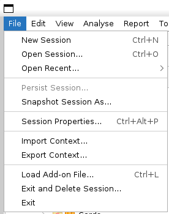
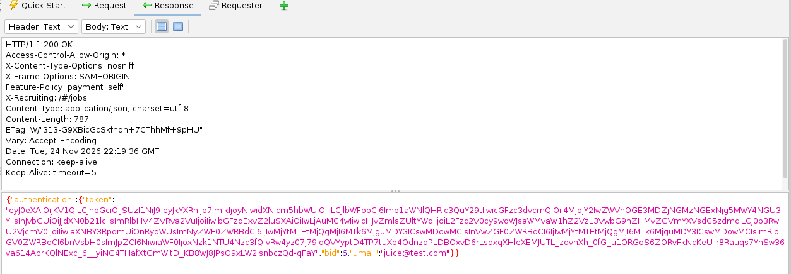

## juice_shop.md

Comments are the four prose paragraphs, numbered 0–3 in order of appearance.

### 0. nmap finds ports; it doesn't open them, and targets carry no port (juice_shop.md - comments 0, 3) [Mechanism]
#### User's Discovery/Doubt:
> I don't even remember what nmap was for...

> It didn't work the way I expected
#### Verdict:
Wrong - the command treats `IP:port` like a URL, but an nmap target is a host only. Ports go in their own option, and you reach the app with a browser.
#### Explanation:
nmap is a **network scanner**. It sends probes and reports which hosts are up and which ports are open, closed or filtered. It never connects you to the service. nmap reads everything after the options as a **target specification** (hostname, IP, CIDR or range). So it took `132.248.185.212:3000` as a hostname, the DNS lookup failed, and it scanned 0 hosts. You choose ports with `nmap -p <ports> <target>`. Next pitfall (verified): nmap quits if you pass `-F` and `-p` together. Verified with one request: `http://132.248.185.212:3000/` serves the page titled "OWASP Juice Shop".

### 1. A bare IP is a complete target (juice_shop.md - comment 1) [Mechanism]
#### User's Discovery/Doubt:
> Is it enough that I put the plain ip? Don't I need to add a red segment?
#### Verdict:
Wrong - you don't need a segment. A bare IP scans exactly that host, and CIDR notation only widens the target to a range.
#### Explanation:
`/24` fixes the first 24 bits, so it covers all 256 addresses from 132.248.185.0 to .255. Your first output already shows that the bare IP worked: "1 IP address (1 host up)". Adding the segment produced the second output, with 256 addresses and 90 hosts up. Ranges are for discovery when you don't yet know which host you want.

### 2. Repeated open ports aren't copies of Juice Shop (juice_shop.md - comment 2) [Mechanism]
#### User's Discovery/Doubt:
> It is interesting that it is scanning the whole red segment, so I believe the professor must have just copied a version of the Juice Shop. Then I think I should just access the specific port
#### Verdict:
Partly correct - going to the specific port is right. But the ports that repeat across hosts are not copies of Juice Shop. Juice Shop is the port 3000 service, and only .212 shows it.
#### Explanation:
Juice Shop is a Node.js app that listens on **TCP 3000** by default. nmap's SERVICE column is a lookup by port number in its `nmap-services` table, not a detection. The table lists 3000 as "ppp" (verified). Ports 2000 and 5060 show as open on almost every host, including the router at .254. That fits a firewall doing SCCP/SIP inspection that answers on behalf of the hosts behind it. This part is inferred, not verified. Version detection (`-sV`) on those ports of one host would settle it.

### 3. Unprompted correction: `-oA` overwrites (juice_shop.md) [Mechanism]
#### User's Discovery/Doubt:
> (no comment; every run reuses `-oA sneaky_scan`)
#### Verdict:
Wrong - reusing one `-oA` basename doesn't keep earlier results. Each run overwrites all three files.
#### Explanation:
`-oA <basename>` writes `.nmap`, `.gnmap` and `.xml` files and overwrites any that exist. Verified: the files in this folder hold only the failed 08:55 run. The 08:50 scan that found port 3000 now exists only in your notes. `--append-output` changes this, but appended XML generally won't parse.

### 4. The `'` probe and the `[object Object]` on the form (juice_shop.md - comment 4) [Mechanism]
#### User's Discovery/Doubt:
> I remember the trick of my professor of using ' in order to see if there was the possibility of SQL injection. When I put a ' both in the Email and the Password I got

> [object Object]

> on top of the form
#### Verdict:
Partly correct - using `'` to probe for SQL injection is right; the belief to fix is that `[object Object]` is the SQL error. It is the browser stringifying a JavaScript error object, which only indirectly confirms your input reached the backend.
#### Explanation:
A single quote is the string delimiter in SQL. If the app pastes your input straight into a query, an odd quote breaks the syntax and the database raises an error — the classic signal that the field may be injectable. What you saw is one step removed from that. The frontend received an error object from the server and rendered it with JavaScript's default string conversion, which for a plain object is the literal text `[object Object]`. So you learned the server threw an error on the quote (promising) but the message itself was swallowed by the UI. The standard next move is to read the real error: open the browser devtools Network tab and look at the failing request's JSON response body, which usually carries the raw SQL message. This is the general behaviour of JS objects, not something specific to this app.

### 5. Whether the scans were pointless given one target (juice_shop.md - comment 5) [Mechanism]
#### User's Discovery/Doubt:
> So for what I understand there is no point in doing the nmap scans, as I just have one address that interests me.
#### Verdict:
Partly correct - host *discovery* across a range is indeed moot once you know the host, but scanning that one host is still the point: it tells you which ports and service versions are exposed.
#### Explanation:
There are two jobs people call "scanning". One is discovery: sweeping a `/24` to find which hosts exist. That you no longer need. The other is enumeration of a known host: which ports are open, and what software and version answers on each (`-sV`). For a web target that second job is where the value is — it confirms the app is on 3000 and can reveal the stack behind it. The exploitation itself then happens in the browser, not in nmap.

### 6. Is the OS worth knowing (juice_shop.md - comment 6) [Correct]
#### User's Discovery/Doubt:
> I don't know if I need to know the OS, but it seems like valuable information
#### Verdict:
Correct - the OS is standard recon. For a web-app task like Juice Shop it is usually marginal, since the vulnerabilities live in the application, not the kernel.

### 7. Why OS and SYN scans need sudo (juice_shop.md - comment 7) [Lookup]
#### User's Discovery/Doubt:
> Again I got that first of all I need to use sudo, why is that?
#### Verdict:
No prior assumption - you asked without proposing an answer.
#### Explanation:
`-O` (OS detection) and `-sS` (SYN scan) build raw IP/TCP packets and read raw replies rather than going through the normal connect() system call. Opening a raw socket is a privileged operation on Linux, so the kernel requires root (or the `CAP_NET_RAW` capability). Without it nmap falls back to `-sT`, which needs no privilege but is slower and more visible.

### 8. The scan ran against the wrong host (juice_shop.md - comment 8) [Mechanism]
#### User's Discovery/Doubt:
> Afterwards I got the problem again that I can scan the port
#### Verdict:
Wrong - two separate failures: `IP:3000` fails as before, and the address you fell back to is not the Juice Shop host at all.
#### Explanation:
Appending `:3000` failed for the reason in entry 0 — a port is not part of an nmap target. The second command dropped the port but typed `132.248.212`, three octets instead of four. nmap pads a short dotted address by inserting zeros before the last octet, so it became `132.248.0.212` — verified here with `nmap -sL`. That is a different machine from the Juice Shop at `132.248.185.212`. The open ports it found (21, 25, 80, 110, 143, 443) look like a mail/web server, and port 3000 is absent, which is the tell that you scanned the wrong host. Every `?` after a service name (`ftp?`, `http?`) means `-sV` could not confirm the service from its banner, only guess from the port number.

### 9. How nmap guesses the OS, and why it couldn't here (juice_shop.md - comment 9 and the "Rocky Linux / docker" note) [Mechanism]
#### User's Discovery/Doubt:
> How does nmap even know what OS is attacking? What are the telltale signs?

> I assume the reason why it can't guess is that my professor put it in a docker container (which is probably Rocky Linux) but as it didn't went too far (I think to avoid detection) it could not be sure.
#### Verdict:
Wrong - the failure is not a container hiding, nor a deliberately shallow scan; nmap simply lacked enough open+closed ports to fingerprint, partly because this was the wrong host.
#### Explanation:
OS detection is TCP/IP **stack fingerprinting**. nmap sends about sixteen crafted probes and measures how the stack replies: the TCP initial sequence number pattern, default window size, which TCP options appear and in what order, the IP TTL, the don't-fragment bit, and specific ICMP behaviours. It matches that signature against `nmap-os-db`. The method needs at least one open and one closed port to calibrate; "test conditions non-ideal" means it didn't get that clean pair. A container doesn't hide this — a Docker container shares the host's Linux kernel, so it would fingerprint *as* that kernel, not mask it. The "Linux 3.X" guess is also suspect precisely because you scanned `132.248.0.212`, not the Juice Shop host.

### 10. What profinet is (juice_shop.md - comment 10) [Lookup]
#### User's Discovery/Doubt:
> What are profinet devices?
#### Verdict:
No prior assumption - a definition question.
#### Explanation:
PROFINET is an industrial Ethernet protocol used in factory and process automation to talk to PLCs and other control hardware (originally Siemens). A `safe` script probed for it and reported none on your subnet, which is expected — you are on an office/lab network, not an industrial control one.

### 11. What `--script safe` actually guarantees (juice_shop.md - comment 11) [Mechanism]
#### User's Discovery/Doubt:
> For what I recall the command script safe was used so the requests of nmap would not serve as an unintended DOS.
#### Verdict:
Partly correct - `safe` does avoid harming the target, but the guarantee is about script *behaviour*, not request *volume*; it is not a rate limiter against DoS.
#### Explanation:
NSE scripts are tagged by category. `safe` is the set whose authors judged they won't crash services, exploit anything, use large resources, or otherwise be seen as hostile — the opposite category is `intrusive`. So `--script safe` won't *do* something damaging to the target. It does not throttle how fast packets go out; flooding a fragile host is controlled by the timing templates (`-T0`..`-T5`) and `--max-rate`, not by the script category. Your instinct — "don't accidentally break it" — is right; the mechanism is script selection, not traffic shaping.

### 12. Are PEAP / EAP-MSCHAPv2 / EAP-TLS / EAP-TTLS all MITM-vulnerable (juice_shop.md - comment 12) [Mechanism]
#### User's Discovery/Doubt:
> I imagine PEAP, EAP-MSCHAP-V2, EAP-TLS, EAP-TTLS are protocols of communication and that one if not all of them might be vulnerable to a network sniffer (a man in the middle)
#### Verdict:
Partly correct - they are 802.1X/WPA-Enterprise authentication methods, and the "not all" caution is the key: EAP-TLS is the strong one, the others are only vulnerable under a specific misconfiguration.
#### Explanation:
These are EAP methods for network authentication, not general comms protocols. The real risk is not passive sniffing — the credential exchange runs inside a TLS tunnel — but an **evil-twin** attack where a rogue access point impersonates the real one. PEAP and EAP-TTLS wrap an inner password method (often MSCHAPv2, which is weak and crackable offline if captured). They are safe *only if* the client is configured to verify the server's certificate; if it isn't, a fake AP completes the tunnel and harvests the inner credentials. EAP-TLS is the outlier: it authenticates both sides with certificates, so there is no password for a rogue AP to steal. So "if not all" is the right hedge — EAP-TLS is the robust one.

### 13. NSE timing lines and the frozen terminal (juice_shop.md - comment 14) [Lookup]
#### User's Discovery/Doubt:
> What are these things of NSE Timing? My terminal doesn't allow me to put any other command nor to exit, and I don't know if it is actually doing something.
#### Verdict:
No prior assumption - you asked what the lines mean and whether it is stuck.
#### Explanation:
NSE is the Nmap Scripting Engine. Those lines are live progress for the script phase: percent complete and an estimated time to completion. The terminal is "stuck" because nmap holds the foreground until the scan finishes — it is working, not hung. Press any key (or Enter) to print an immediate status line; press Ctrl-C to abort. This is terminal/tool behaviour, not something about the target.

### 14. The 500 is the finding, not background noise (juice_shop.md - comment 15) [Mechanism]
#### User's Discovery/Doubt:
> It seems that I can see an error...

> Failed to load resource: the server responded with a status of 500 (Internal Server Error)

> I don't actually see anything relevant, just the loading of the necessary componentes for the page to run.
#### Verdict:
Wrong - the `500 Internal Server Error` is the relevant line; the rest are just the page's own assets loading, and the detail you want is one level inside that one request.
#### Explanation:
The Network tab lists every request the page makes, and most are what you noticed — scripts, styles and images the app pulls to render. The single line that matters is the one that returned 500. A 500 means the server-side code hit an unhandled error while processing that request, which is exactly what a malformed input is meant to provoke: the backend choked rather than rejecting you cleanly. The message you're after is not in the request list; it is in that request's own detail. Click the failing request, then open its **Response** (or **Preview**) sub-tab, which holds the body the server sent back. The `[object Object]` from entry 4 was that same body after the UI flattened it to a string — here you see it raw.

### 15. Why the earlier turn was cut off (juice_shop.md - comment 16) [Lookup]
#### User's Discovery/Doubt:
> It seems that I messed up with the host and that was probably the reason why Claude Opus 5.5 put me a guardrail.
#### Verdict:
Wrong - the cut-off came from an automated safety classifier reacting to the wording of the exchange, not from which host was scanned; the two are unrelated.
#### Explanation:
The guardrail is a separate automated system that reads the text of a turn. It has no notion of nmap targets or of a right-versus-wrong IP, so scanning `132.248.0.212` did not trigger it. Naming the setting plainly — a supervised OWASP Juice Shop lab — is what lets the explanations continue.

### 16. How you issue a GET, and what 200 OK actually means (juice_shop.md - comments 17, 19) [Mechanism]
#### User's Discovery/Doubt:
> On step one it says that "GET http://localhost:3000/rest/user?sort=price:ASC,createdAt:DESC" but where I am supposed to do this? mmm for what I know get is a way in which machines communicate, so if I get 200 OK I assume that means the database is exposed.

> It seems I cannot simply use get blindly

> GET 132.248.185.212:3000/rest/user?sort=price:ASC,createdAt:DESC
> GET: command not found
#### Verdict:
Wrong - two false beliefs: that `GET` is a shell command, and that a 200 OK means the database is exposed. GET is an HTTP method issued by an HTTP client, and 200 means only that the request succeeded.
#### Explanation:
HTTP defines request methods; GET asks a server for the resource at a URL. Your shell replied `GET: command not found` because the shell has no program by that name — the word is meaningful only inside an HTTP client. You send one by pasting the full URL, scheme included (`http://...`), into a browser's address bar, which always makes a GET; or with `curl -i 'http://host:3000/path'`; or from the devtools. Note the guide's address is `localhost:3000`, which means the machine running the app — from your side you substitute the lab host. The status code reports that one exchange: 200 = handled and a body returned, 500 = it errored. A 200 is the ordinary reply for virtually every working URL, so it says nothing about a database being "exposed." What carries meaning is the response body — for this endpoint, the JSON the API is built to return.

### 17. The verbose 500 page is itself a finding (juice_shop.md - comment 20) [Mechanism]
#### User's Discovery/Doubt:
> I don't know if the "response/preview" sub tab is simply clicking the error message, but I got this

> OWASP Juice Shop (Express ^4.22.1) / 500 Error: Unexpected path: /rest/user/login ... at /juice-shop/build/routes/angular.js:42:18
#### Verdict:
Partly correct - yes, the Response/Preview sub-tab is exactly what you reach by drilling into the failing request (the move from entry 14). The belief to fix is reading this as "just an error." That full stack trace is a finding in its own right: information disclosure.
#### Explanation:
A hardened server returns a terse 500 with no detail. This one hands back a full Express stack trace, which leaks internals an attacker would otherwise have to guess: the framework and version (`Express ^4.22.1`), absolute server paths (`/juice-shop/build/routes/angular.js`, `/juice-shop/node_modules/...`), and the exact route file that handled the request. `Unexpected path: /rest/user/login` is thrown by the app's own `angular.js` handler. Leaking paths, versions and structure is its own vulnerability class (OWASP "Security Misconfiguration" / verbose errors) because it draws the map that the guide's Phase-3 static analysis would otherwise have to reconstruct. This body is the raw form of the `[object Object]` from entry 4 — the same server error, shown before the UI flattened it to a string.

### 18. `GET` typed into the Console runs as JavaScript (juice_shop.md - comment 21) [Mechanism]
#### User's Discovery/Doubt:
> For what I understood the GET method was supposed to be executed in the console as it is a http method, but it doesn't work

> GET http://localhost:3000/rest/user?... / Uncaught SyntaxError: Unexpected identifier 'http'
#### Verdict:
Wrong - the devtools **Console** is a JavaScript interpreter, not an HTTP client and not a shell, so `GET http://...` is parsed as JavaScript and dies at the word `http`.
#### Explanation:
Three places get mixed up and they are different tools. (1) Your OS **terminal** runs shell commands like `curl`. (2) The devtools **Console** runs JavaScript. (3) The browser **address bar** issues a GET for you. Typed into the Console, `GET http://...` is read as code: `GET` looks like a variable, then `http` is a second identifier with no operator between them — hence "Unexpected identifier 'http'". The JavaScript way to make that request from the Console is `fetch('http://host:3000/rest/user?...').then(r => r.json()).then(console.log)`. From the address bar, paste the whole `http://...` URL. From the terminal, use `curl`. One request, three syntaxes — you were using the wrong one for the venue.

### 19. curl belongs in the terminal, and `-s` hides the output (juice_shop.md - comment 22) [Mechanism]
#### User's Discovery/Doubt:
> When I tried with curl it didn't work either, and while I recognize this is a terminal command when I run it in my terminal I don't get any output either

> curl -s "http://localhost:3000/rest/user?sort=price:ASC,createdAt:DESC-- -" | head -c 200 / Uncaught SyntaxError: Unexpected string
#### Verdict:
Partly correct - curl is the right tool, but the two failures have two causes: you pasted it into the Console again (JavaScript), and in the terminal `-s` is why it looked silent.
#### Explanation:
The `VM...:1 Uncaught SyntaxError` prefix is the tell that you were still in the JS **Console** — `VM###` is how Chrome labels code typed there — not the terminal. curl only means something in the OS terminal. There, `-s` ("silent") suppresses curl's progress and error messages, and `| head -c 200` keeps only the first 200 bytes, so an empty or error reply prints nothing at all. To see what really happened, drop `-s` and add `-i`: `curl -i 'http://host:3000/rest/user?sort=...'` prints the status line and headers, so even an empty body still shows you 200 vs 500. One more detail: the trailing `-- -` in your URL is a SQL-comment payload; whether the endpoint reacts to it is exactly what reading the status and body would tell you. Keep it to your lab instance.

### 20. Exploring like a normal user is the method, not a detour (juice_shop.md - comment 23) [Correct]
#### User's Discovery/Doubt:
> In the Guia de Estudio it says that I should simply explore the site like a normal person, which makes sense.
#### Verdict:
Correct - this is passive reconnaissance / application mapping, and both class guides open with it ("Navega por la aplicación como un usuario normal"). Clicking through every feature first is how you build the map the later phases act on, so it is a phase, not a warm-up.

### 21. A form is an input surface (juice_shop.md - comment 24) [Mechanism]
#### User's Discovery/Doubt:
> The `http://132.248.185.212:3000/#/contact` looks promising, as it is a form.
#### Verdict:
Correct, and worth sharpening - a form is promising because it is an **input surface**: a place your data crosses into the server, which is where injection and stored-XSS live. The feedback/contact form is one the class guide calls out by name ("Inyección en el Feedback").
#### Explanation:
Recon value is not the page's text, it is where input enters and where output later comes back. A feedback form takes a comment and stores it; if that stored value is later rendered to someone (say an admin view) without being sanitised, that is the setup for **stored XSS**. The habit to build: note every field that accepts input and every place output is shown, and ask "does what I type come back unescaped?" Test only your own lab instance.

### 22. Bluesky is real, and the About page's value is its links (juice_shop.md - comment 25) [Lookup]
#### User's Discovery/Doubt:
> In `http://132.248.185.212:3000/#/about` there doesn't seem to be anything of use for an attacker, however I didn't know that there was a twitter clone called "Bluesky".
#### Verdict:
Partly correct - two things. Bluesky is not a "clone"; it is a real, separate decentralised microblogging network. And the About page is worth a second pass — for its **links**, not its prose.
#### Explanation:
Bluesky is an actual platform built on the AT Protocol, independent of Twitter/X, so that text is just flavour. The recon habit to take from this: on a page that "has nothing," check its links and the requests it makes, not its copy. Juice Shop's About page carries links that point back at server-side files, and following a link to a stored document is a common low-level challenge. Hover each link, see where it goes, and open the ones aimed at the app's own host and paths.

### 23. The photo wall is user-generated content (juice_shop.md - comment 26) [Mechanism]
#### User's Discovery/Doubt:
> In `http://132.248.185.212:3000/#/photo-wall` there doesn't seem to be anything interesting either.
#### Verdict:
Partly correct - visually there is little, but like the feedback form the photo wall is a **user-generated-content** feature (users post captions and images), so it is an input-and-output surface, not decoration.
#### Explanation:
Same lens as entry 21: anywhere users submit content that others later view goes on your map. Keep it listed even if nothing jumps out now — the value appears once you are testing how submitted content is stored and re-rendered.

### 24. The Score Board is the built-in objective list (juice_shop.md - comment 27) [Correct]
#### User's Discovery/Doubt:
> In `http://132.248.185.212:3000/#/score-board` it is surprising to me the amount of challenges that the page has.
#### Verdict:
Correct - the Score Board enumerates every challenge and lights up automatically when you solve one; the class guide treats it as the validation mechanism ("El Scoreboard se actualiza automáticamente").
#### Explanation:
Two things to know. Finding the Score Board is itself the first intended challenge — it isn't in the menu, so reaching it by guessing the `/score-board` route *is* the exercise. And you can filter it by difficulty and category to set a sensible learning order; in "hardened" mode some hints are hidden.

### 25. The search field is the primary injection surface (juice_shop.md - comment 28) [Mechanism]
#### User's Discovery/Doubt:
> In `http://132.248.185.212:3000/#/search` I assume there is nothing interesting either, as it is simply the products.
#### Verdict:
Wrong - the search is the opposite of uninteresting; it is the surface both guides point to first. The results are products, but the **`q` parameter** that fetches them is the classic injection point.
#### Explanation:
What matters is not the product list, it is the request the page makes to build it: the search box sends your text as the `q` query parameter to a REST endpoint, and that value reaches the database. Both guides put SQL injection in the search field at the top (the Guía de Estudio's "Búsqueda de Productos"; the other guide's `' OR 1=1-- -`). So read the search box as a data flow: input → `q=` query parameter → SQL query → JSON response. Watch the Network tab while you search to see the `q=` call fire. Keep all of this inside your lab instance.

### 26. dirsearch is a real technique: content discovery (juice_shop.md - comment 30) [Lookup]
#### User's Discovery/Doubt:
> Is `dirsearch` an actual technique? Or is it simply to explore the website manually as I have been doing in the previous steps?
#### Verdict:
No prior assumption - you asked whether it is real or just manual browsing.
#### Explanation:
It is a real, distinct technique called **content discovery** (or directory / forced browsing). `dirsearch` is a tool that requests many candidate paths from a wordlist (`/admin`, `/backup`, `/ftp`, `/.git`, ...) and reports which return something other than 404, surfacing pages that aren't linked anywhere in the UI. It complements manual browsing rather than replacing it: browsing finds what the app shows you, content discovery finds what it doesn't. Run it only against your authorised lab host.

### 27. ffuf is a web fuzzer (juice_shop.md - comment 31) [Lookup]
#### User's Discovery/Doubt:
> What is `ffuf`?
#### Verdict:
No prior assumption - a definition question.
#### Explanation:
`ffuf` ("Fuzz Faster U Fool") is a fast web fuzzer. You place the marker `FUZZ` in a URL and give it a wordlist; it substitutes each word and reports the responses — your guide's example is `ffuf -u http://localhost:3000/FUZZ -w <wordlist>`. It does the same content-discovery job as dirsearch, but because `FUZZ` can go anywhere (path, parameter name, parameter value, header), the same tool also brute-forces parameters and values. Same rule: lab host only.

### 28. A cookie is session state, not cache (juice_shop.md - comment 32) [Mechanism]
#### User's Discovery/Doubt:
> That `continueCode` cookie seems interesting... but what is a cookie to begin with? I understand them as "cache" memories that the browsers store locally, and I suppose their importance in cybersecurity comes that they allow bot behavior that acts as an actual human visiting the site.
#### Verdict:
Partly correct - stored client-side, yes, but a cookie is not cache and its security weight is not "bot behaviour." A cookie is **state the browser attaches to every request** to a site, above all the identifier that tells the server who you are.
#### Explanation:
Cache stores copies of files (images, scripts) to avoid re-downloading them. A **cookie** is a small key/value the server sets and the browser then sends back on every later request to that origin. That automatic re-sending is what makes cookies the backbone of **sessions**: after you log in, your session cookie is how the server recognises you on the next click. That is also why they matter in security — steal or forge a session cookie and you act as that user (session hijacking), which is the real concern, not botting. The one you spotted, `continueCode` (image-1), is Juice Shop's own: it encodes which challenges you've solved so your Score Board progress survives a reset — a lab convenience, not a credential. Note that Juice Shop keeps its actual login token in **Local Storage**, not a cookie — see the next entry.

### 29. Local Storage is the pane that matters (juice_shop.md - comment 33) [Mechanism]
#### User's Discovery/Doubt:
> What other subsections could prove interesting? I assume that `Back/forward cache` could be one, `Cache storage` could be another and probably `IndexedDB` as one of the 3 most important ones.
#### Verdict:
Partly correct - good instinct to comb the Application tab, but those three are the quiet ones. In Juice Shop the subsection that matters most is **Local Storage**, which is right there in image-1 but you passed over it.
#### Explanation:
The class guide points straight at it: "DevTools → Application → LocalStorage ... Ver tokens." After you log in, Juice Shop stores your **authentication token (a JWT)** in Local Storage. That makes it the high-value pane: it holds the credential that authorises your API calls, and reading or altering tokens is Phase-3/Phase-4 work in the guide. IndexedDB, Cache Storage and bfcache (next entry) are empty or performance-only here. So reorder your attention: Local Storage first, the rest noted as "confirmed empty."

### 30. IndexedDB, Cache Storage and bfcache — empty is a valid result (juice_shop.md - comments 34, 35, 36) [Lookup]
#### User's Discovery/Doubt:
> When I clicked `IndexedDB` it appeared that there was "No IndexedDB detected", so I assume it is a larger storage version of `LocalStorage`...

> In `Cache storage` I didn't found anything either...

> `Back/forward cache` seems to only be a service to see if the connection of the cache is stablished and stored...
#### Verdict:
Correct on all three, with one framing fix - these are storage and performance mechanisms, and finding them empty is itself a valid recon result ("nothing here"), not a dead end.
#### Explanation:
Your reads are right. **IndexedDB** is a structured in-browser database that stores typed JavaScript values (numbers, dates, blobs, objects) under keys — effectively a larger, typed counterpart to Local Storage, which only stores strings; "No IndexedDB detected" just means this app doesn't use it. **Cache Storage** holds responses cached by a Service Worker (how progressive web apps work offline); empty means no such caching here. **Back/forward cache** keeps a whole page in memory so Back/Forward is instant — purely about speed, no attacker value, and "served from bfcache" is just it confirming that worked. Writing down "checked, empty" for each is good documentation.

### 31. The WebSocket is Socket.IO, not a hidden exfil daemon (juice_shop.md - comment 37) [Mechanism]
#### User's Discovery/Doubt:
> That there is a websocket open seems exciting, as for what I recall websockets are a communication protocol that is practically always run as a daemon, so if I get to vulnerate it I could probably steal data without the owner noticing.
#### Verdict:
Partly correct - you correctly spotted a live WebSocket, but the model to fix is "a daemon you quietly break to steal data." A WebSocket is just a long-lived two-way channel between this page and the server; here (image-2) it is **Socket.IO**, which Juice Shop uses to push things like challenge/Score-Board notifications.
#### Explanation:
A WebSocket upgrades an HTTP connection — note the **101 Switching Protocols** status on the `transport=websocket` row — into a persistent bidirectional pipe, so the server can push messages without the client asking again. It is not a background service you attack by default, and it is not inherently stealthy: it rides the same origin and is sitting in plain view in the Network tab's Socket filter. Its traffic is readable in devtools (select the socket row → Messages). Worth watching to learn what the app pushes in real time; the `polling` rows beside it are Socket.IO's fallback transport doing the same job over ordinary HTTP.

### 32. XHR is a browser API, not a transport protocol (juice_shop.md - comment 38) [Lookup]
#### User's Discovery/Doubt:
> Of the other I have never heard of the `xhr` type. What is that? They also have the name of socket at the beginning, so I assume it is just a different protocol, like TLS.
#### Verdict:
Wrong - XHR is not a transport like TLS. **XHR = XMLHttpRequest**, the browser's JavaScript API for making HTTP requests from a page (the original "AJAX"). The Type column names *how* each request was initiated, not a protocol.
#### Explanation:
The Network tab's Type says what kind of request each row is: `xhr` means the page's JavaScript fetched it in the background via XMLHttpRequest (or the newer `fetch`); `websocket` is the persistent channel from the last entry; other rows would read `document`, `script`, `img`. The "socket.io" at the start of those rows is just the **URL path** they target (`/socket.io/?...`), not a protocol — Socket.IO falls back to XHR "polling" when it isn't on a WebSocket, which is why the same name shows up on both types. TLS is different in kind: it is encryption sitting underneath HTTP, a lower layer entirely.

### 33. The Sources tab shows real, minified code — devtools isn't scrambling it (juice_shop.md - comments 39, 40) [Mechanism]
#### User's Discovery/Doubt:
> I knew that you could access code from the browser, but I didn't knew it was this organized

> I assume chrome web dev tools automatically changes the names and even messes up the css in order for you to have an idea of how things are organized but that you can't simply copy the code and have a copy of the website.
#### Verdict:
Partly correct - the Sources tab does lay out the app's files, but the misconception to fix is that devtools scrambles names and CSS to stop you copying. It doesn't. You are looking at the **real deployed code**; it looks mangled because the **build step minified** it, and devtools can un-minify it for you.
#### Explanation:
The Sources tree (image-3) is exactly the JavaScript and CSS the server sent — `main.js`, `polyfills.js`, the `chunk-*.js` bundles, `styles.css`. Before deployment, Angular runs a **build/minify** step that strips whitespace and shortens variable names to shrink the download; devtools is not doing that and is not hiding anything, which is why you *can* read and copy it. The `{ }` "pretty-print" button at the bottom reformats minified code back to a readable layout (it can't restore the original long names, but the structure returns). Reading these bundles is the guide's **Phase 3, static analysis** — Angular's route and service files reveal API endpoints (`/rest/...`, `/api/...`) that never appear in the UI. On your last point: a true clone would still need the server side, which never leaves the server; the bundles are only the client half.

### 34. You're not stuck — turn recon into a plan (juice_shop.md - comment 41) [Mechanism]
#### User's Discovery/Doubt:
> How could I continue attacking the Juice Shop? I am stuck.
#### Verdict:
No prior assumption - you're asking for direction. Here is a path built only from what you have already found and what your class guides lay out, all inside your lab instance.
#### Explanation:
You've actually finished reconnaissance (Phases 1–2) and have the map; the next move is to turn it into a plan:
1. **Pick targets from the Score Board.** Filter by 1-star difficulty and let it define your objective list and categories (entry 24). Work easy → hard; the guide warns against skipping levels.
2. **Follow the data, not payloads.** The instructor's note is the whole method: trace each input from where you type it, through the request (watch it in Network), to the response. You've already located the inputs — the **search `q` parameter** (entry 25), the **feedback/contact form** (entry 21), the **login fields** (entry 4).
3. **Start where both guides start — search and login — with the `'` probe you already ran (entry 4).** Reading the raw error body (entries 14, 17) is how you tell whether a field reaches the database. That is the SQL-injection track the Guía de Estudio builds up (tautologies → SQL comments → UNION → error-based).
4. **Read your token.** After logging in, open **Application → Local Storage** (entry 29) and look at the JWT; decoding its base64 structure is the start of the guide's JWT/auth track.
5. **Mine the bundles.** Use the Sources tab (entry 33) to list `/rest/...` and `/api/...` endpoints the UI never shows, then try them.
6. **Consider the discovery tools** (`dirsearch` / `ffuf`, entries 26–27) against the lab host to surface unlinked paths — like the Score Board you found by guessing.
Keep documenting in the guide's Endpoint → Method → Payload → Response → Impact format, reset the instance when state gets messy, and test only this authorised instance.

## report.md and chat

Entries 36–50 follow report.md in order of appearance; 51 onwards come from the chat.

### 35. Which nuclei templates are the "relevant" ones (report.md / chat - Módulo 1) [Lookup]
#### User's Discovery/Doubt:
> What are the relevant templates I need to have?

> the instructions in `./evaluacion.md` say that I should use certain relevant nuclei templates. Which are those?
#### Verdict:
No prior assumption - you asked which ones without proposing any. "Relevant" means the categories the guide lists (exposures, security headers, detected technologies). Nuclei selects those by **tag**, and the severity filter has to include `info`.
#### Explanation:
Run from this folder (nuclei comes from the repo's flake):
```bash
nuclei -u http://127.0.0.1:3000 -pt http \
  -tags exposure,misconfig,headers,tech \
  -etags intrusive,default-login \
  -s info,low,medium,high \
  -ni -rl 10 -c 5 \
  -jle nuclei_juice.jsonl -me nuclei_md
```
- `-u http://127.0.0.1:3000`: targets only the local instance, as the scope rules require.
- `-pt http`: runs only HTTP templates, because the target is a web app.
- `-tags exposure,misconfig,headers,tech`: the guide's categories, in nuclei's tag names. `exposure` covers exposed files and information disclosure. `misconfig` covers misconfigurations, including headers, CORS and cookies. `headers` covers security headers. `tech` covers technology detection. Verified: this takes the 13,806 installed templates (v10.5.2) down to about 3,000.
- `-etags intrusive,default-login`: drops 70 templates that try default passwords or change the server (`put-method-enabled`, for example, uploads a file). This keeps the scan non-invasive.
- `-s info,low,medium,high`: the guide names low, medium and high, but you also need `info`. `http-missing-security-headers` and the technology templates are all `info`, so without it you lose the missing-headers finding the deliverable asks for.
- `-ni`: turns off interactsh. Ten of the selected templates confirm a hit by making the target call back to an external server (`oast.pro` and similar), which would break the localhost-only rule.
- `-rl 10 -c 5`: at most 10 requests per second (default 150) and 5 templates in parallel (default 25). This is the rate limit and low concurrency the guide asks for.
- `-jle` / `-me`: writes a JSONL file plus one Markdown file per finding. Both include the request and response that triggered each rule by default, which gives the traceability the guide asks for.

What to expect is inferred, since I didn't run the scan. With one request I verified that the instance sends no CSP, HSTS or Referrer-Policy and does send the deprecated `Feature-Policy`. So `http-missing-security-headers` and `deprecated-feature-policy` should fire. `prometheus-metrics` (`/metrics`), `swagger-api` (`/api-docs`), `owasp-juice-shop-detect` and `tech-detect` should fire too. For the false-positive column: Juice Shop answers any unknown path with `200` and its main page (verified: `/does-not-exist-xyz.bak` returned the same 9,831 bytes as `/`). So treat an exposure hit on a file like `/backup.zip` as suspect until `curl -i` shows real content. One gap: `cors-misconfig` only fires when the server reflects the origin and also sends `Access-Control-Allow-Credentials: true`, so it misses Juice Shop's `Access-Control-Allow-Origin: *`. ZAP's passive scan in Módulo 2 flags that one.

### 36. Tools go in the flake (report.md) [Correct]
#### User's Discovery/Doubt:
> Now I need to install nuclei, which I should just put in my flake.nix if I am not mistaken.
#### Verdict:
Correct - adding a package to the devShell's list in `flake.nix` is how this repo gets its tools. direnv reloads the shell when the file changes, and nothing is installed system-wide.

### 37. `-t` takes templates, not the target (report.md) [Mechanism]
#### User's Discovery/Doubt:
> I am checking at a guide some years ago and I found this ... `nuclei -t https://example.com -t ~/nuclei-templates/`

> So at least that command doesn't work
#### Verdict:
Correct that it fails - but the cause is the flag, not the guide's age. `-t` names templates; the target goes after `-u`.
#### Explanation:
Because the URL came after `-t`, nuclei treated `https://example.com` as a remote template to download and refused it: "Remote template URL host (example.com) is not present in the `remote-template-domain` list". The working shape is `nuclei -u <target> -t <templates>`. `example.com` was the guide's placeholder; under this lab's rules the only target is `http://127.0.0.1:3000`.

### 38. The 0-match scans failed on the URL, not the template choice (report.md) [Mechanism]
#### User's Discovery/Doubt:
> For what it seems I am scanning with all the templates instead of the relevant ones... that was a mistake.

> I did it again... but this should be a mistake, doesn't it? the juice shop is full of vulnerabilities and it found none
#### Verdict:
Partly correct - both 0-result scans were mistakes, but running all templates wasn't what broke them. Each had a target URL nuclei couldn't reach.
#### Explanation:
The first used `https://127.0.0.1:3000`. Juice Shop serves plain HTTP, so every TLS handshake failed (verified: `curl -k https://127.0.0.1:3000` exits with code 35, an SSL connect error). nuclei's own summary shows it: "HTTP connections: 4 total" for 11,330 templates. The "Skipped 127.0.0.1:5814 / 4040" lines are templates that probe other ports where nothing listens, which is harmless. The second used `http:127.0.0.1:3000`, which lacks the `//` and so isn't a URL. nuclei fell back to probing it as a host, "Found 0 URL from httpx", and scanned nothing in 26 seconds. All templates against the right URL would have been slow and noisy, not blind. Your filtered scan with the right URL found 14 matches (entry 35).

### 39. dns, headless and websocket are protocols; Juice Shop is an http target (report.md) [Mechanism]
#### User's Discovery/Doubt:
> The ones that seem the most relevant are dns, headless, websocket.
#### Verdict:
Wrong - those top-level folders sort templates by protocol, and almost everything that applies to a web app is in `http/`.
#### Explanation:
Verified counts: `http/` 11,835 templates, `dns/` 31, `headless/` 26, `websocket/` 1. DNS templates query a domain's DNS records, and a bare IP like 127.0.0.1 has none. Headless templates drive a browser and only run when you add `-headless`. The single websocket template targets one specific product. The subfolders that matter here sit inside `http/`: `exposures/`, `misconfiguration/`, `technologies/`. Your working scan confirms it, since all 14 matches are `[http]`. Selecting by `-tags` (entry 35) beats selecting by folder, because a tag gathers matching templates from every folder.

### 40. `-j` with `-o` is the other way to get JSONL (report.md) [Correct]
#### User's Discovery/Doubt:
> The professor says that `-jsonl` is to save it in JSONL and with `-o` I gave the file the name.
#### Verdict:
Correct - `-o <file>` writes the findings to a file and `-j`/`-jsonl` makes that file JSONL. `-jle <file>` (entry 42) produces a JSONL file with a single flag, so either way meets the guide's structured-output requirement.

### 41. `-pt` means protocol type (report.md) [Lookup]
#### User's Discovery/Doubt:
> What does the `-pt` flag mean? I understand that it only runs http but what `-pt` stands for?
#### Verdict:
No prior assumption about the name - and your reading of what it does is right.
#### Explanation:
`-pt` is the short form of `-type`, which `nuclei -h` describes as "templates to run based on protocol type". Its values (dns, file, http, headless, tcp, workflow, ssl, websocket, whois, code, javascript) are the same names as the top-level template folders in entry 39.

### 42. `-jle` and `-me` mean export, and each run replaces them (report.md) [Mechanism]
#### User's Discovery/Doubt:
> I assume the `jle` and `me` mean something like "JSONL extend" and "Markdown extend", so we can have just one file that grows through time instead of being constantly replaced.
#### Verdict:
Wrong - the "e" stands for export: `-jle` is `-jsonl-export` and `-me` is `-markdown-export`. Neither grows; each run replaces the previous results.
#### Explanation:
Verified by running one template twice into the same paths. After the second run the JSONL file still had 1 line and the Markdown folder still held a single finding. To keep evidence from several runs, give each run its own file name (a date suffix works). The export is worth keeping: each JSONL line holds the HTTP `request` and `response` that triggered the finding (all 14 of yours do), plus a ready-made `curl-command` to reproduce it.

### 43. The "missing" files are in the folder you ran nuclei from (report.md) [Mechanism]
#### User's Discovery/Doubt:
> But I don't see the `nuclei_juice.jsonl` or `nuclei_md` files anywhere.
#### Verdict:
Wrong - they were written, one folder up: `/home/nixos/repos/cybersecurity/nuclei_juice.jsonl` and `/home/nixos/repos/cybersecurity/nuclei_md/`.
#### Explanation:
A relative path like `nuclei_juice.jsonl` is resolved against the shell's current directory. Your shell history shows you ran the scan from the repo root, not from `juice_shop/`. Both outputs are complete: 14 lines in the JSONL, and 14 finding files plus `index.md` in `nuclei_md/`. From `juice_shop/`, `mv ../nuclei_juice.jsonl ../nuclei_md .` brings them next to the report.

### 44. Módulo 1 still needs its real-vs-false-positive list (report.md) [Mechanism]
#### User's Discovery/Doubt:
> It seems that I have done everything that was required in this first part
#### Verdict:
Partly correct - the scan is done, and the version and template-update output is already in report.md. The second deliverable, a findings list "diferenciando los hallazgos reales de posibles falsos positivos", isn't written yet.
#### Explanation:
Two of your 14 matches show the judgement the guide wants. `fingerprinthub-web-fingerprints:qm-system` is a false positive: that rule fires on any page containing `src="polyfills.js`, which every Angular app has, and Juice Shop isn't QM System (verified in the template). `tech-detect:google-font-api` is real, because Juice Shop's index page loads `fonts.googleapis.com` (verified). Check the other 12 the same way: open each file in `nuclei_md/` and decide whether the response really shows what the rule claims.

### 45. `zaproxy` is the Debian name; nixpkgs calls it `zap` (report.md) [Correct]
#### User's Discovery/Doubt:
> It didn't work, that probably isn't the name
#### Verdict:
Correct - `error: undefined variable 'zaproxy'` means nixpkgs has no package by that name. Kali and Debian call it `zaproxy`; nixpkgs calls it `zap`. It's fixed in `flake.nix`, together with `firefox` and `geckodriver`, which ZAP's browser-driven spiders need.

### 46. Client Spider is a third spider, not the one the guide names (report.md) [Mechanism]
#### User's Discovery/Doubt:
> With zap I am struggling a lot in finding the tools that Claude tells me, I have version 2.17, the latest, and I went to tools > client spider
#### Verdict:
Partly correct - Client Spider is a real ZAP 2.17 tool, but it isn't the traditional Spider the guide asks for. ZAP 2.17 has three: Spider..., AJAX Spider... and Client Spider....
#### Explanation:
The traditional one is Tools → Spider... (or right-click the site → Attack → Spider...). It reads the HTML the server returns and doesn't run JavaScript. AJAX Spider and Client Spider both drive a real browser; the Client Spider is ZAP's newer one. The guide asks for "Spider tradicional y AJAX Spider", so those are the two to run and screenshot.

### 47. The starting point needs the scheme (report.md - m2_client_spider_dialog, m2_client_spider_error_missing_scheme) [Correct]
#### User's Discovery/Doubt:
> It doesn't allow me to run, as it says I need a valid starting point along with the protocol

> I think the problem is that I am not putting the complete address
#### Verdict:
Correct - m2_client_spider_dialog has `127.0.0.1:3000`, which is a host and port, not a URL. ZAP needs the scheme, `http://127.0.0.1:3000`, as m2_ajax_spider_dialog_empty_context shows. It's the same root cause as nuclei's `http:127.0.0.1:3000` in entry 38.

### 48. The Client Spider was fast because it barely crawled (report.md) [Mechanism]
#### User's Discovery/Doubt:
> Now it works, and it seems it went through everything fairly quickly, which is suspicious for me as my computer is not that powerful. Maybe AJAX will require more power
#### Verdict:
Partly correct - the suspicion is right, but it didn't go through everything. Judging by timestamps, ZAP recorded only 26 requests from it, all within two seconds (08:47:32–34).
#### Explanation:
That's the start page and the files it loads, not a crawl. At startup ZAP's log shows "Failed to get or create Firefox profile zap-client-profile", the browser profile the Client Spider uses, so it likely never got to explore (inferred, not verified). You're right that the AJAX Spider needs more resources, because it runs real browsers (entry 50).

### 49. Scope is the part of the web you tell ZAP is your target (report.md - m2_ajax_spider_dialog_empty_context, m2_ajax_spider_error_not_in_scope) [Mechanism]
#### User's Discovery/Doubt:
> What is the scope in this scenario? I will uncheck that mark for now
#### Verdict:
No prior assumption about what scope is. Unchecking works, but the better fix is to put the site in scope.
#### Explanation:
In ZAP, scope is the set of URLs in a Context marked "in scope". m2_ajax_spider_dialog_empty_context shows an empty Context field, so nothing was in scope and "Just In Scope" rejected the start URL (m2_ajax_spider_error_not_in_scope). Here the scope should be exactly `http://127.0.0.1:3000`: right-click it in Sites → Include in Context → Default Context. That's also the Context the guide's Phase 3 asks you to define, and it keeps the Google domains your browser contacted out of scans. With the box unchecked, "Spider Subtree Only" still kept the crawl under `http://127.0.0.1:3000`.

### 50. The AJAX Spider broke on 12 browsers, not on a weak machine (report.md - m2_ajax_spider_crash_12_browsers) [Mechanism]
#### User's Discovery/Doubt:
> IT seems it broke somewhere along the way, could this be by the poor hardware power of my machine?
#### Verdict:
Partly correct - resources likely played a part, but the cause is a setting: ZAP was told to open 12 browsers.
#### Explanation:
The AJAX Spider's "Number of Browser Windows to Open" was 12, one per CPU core on your machine, since you hadn't opened the advanced options. ZAP's log shows it launching headless Firefox roughly every 15 seconds from 08:50. The 12th didn't start in time (`TimeoutException`), and the crawl aborted with the m2_ajax_spider_crash_12_browsers message. Your WSL VM has 7.4 GiB of RAM and swap was nearly full (1.6 of 2.0 GiB), which fits browsers starting too slowly (inferred). The run wasn't wasted: ZAP recorded about 300 requests from it before it stopped, and they're in the Sites tree even though ZAP counts 0 AJAX Spider results. Re-run with Show Advanced Options → 1 or 2 browser windows and a 10-minute maximum duration.

### 51. What spidering is and how to run it (chat) [Lookup]
#### User's Discovery/Doubt:
> I already went through the entire page manually, but how do I execute the spider? What is spidering? How do I send you the output of the things that Zap tracked?
#### Verdict:
No prior assumption - you asked how, without proposing an answer.
#### Explanation:
A spider (or crawler) maps a site automatically. It requests a page, pulls out every link and URL, queues the new ones, and repeats until nothing new turns up. Its finds land in the Sites tree beside your manual browsing. The traditional Spider reads HTML and doesn't run JavaScript. The AJAX Spider drives a real browser and records the requests the page's JavaScript makes; since Juice Shop is an Angular app, it's the one that finds most routes. Spidering isn't fully passive, because it sends real requests. To run them, put the site in scope first (entry 49), then right-click `http://127.0.0.1:3000` → Attack → Spider... → Start Scan, then Attack → AJAX Spider... with 1–2 browser windows (entry 50). To share results, nothing needs exporting: ZAP's API runs at `127.0.0.1:8080` in the same WSL, and I can read it with the key in `~/.ZAP/config.xml`. A file also works: History tab → Ctrl+A → right-click → Save as HAR....

### 52. The "I/O errors" don't point to failing hardware (chat) [Mechanism]
#### User's Discovery/Doubt:
> I am getting a lot of I/O errors, does this mean that my computer is failing?
#### Verdict:
Wrong - nothing points at the machine. The kernel log has no disk errors and the disk is 9% full. What ZAP logged are network timeouts and the browser start-up timeout.
#### Explanation:
A failing disk shows up as I/O errors in the kernel log (`dmesg`), and there are none. ZAP has three things that look like errors:
1. 13 `504 Gateway Timeout`s, all on `/socket.io/?EIO=4&transport=polling`, Juice Shop's live-notification channel (entry 31). Socket.IO's polling deliberately holds each request open until it has something to push, by default for up to about 25 seconds. ZAP stops waiting after 20 seconds and answers the browser with a 504. It's expected and harmless.
2. 45 entries with the empty status `HTTP/1.0 0`. These are folder entries ZAP adds to the Sites tree (`/assets`, `/rest`, `/api/Users`, ...). They were never sent, so they have no response.
3. The browser start-up timeout in entry 50.

The four "API key incorrect or not supplied" warnings in ZAP's log came from my own test calls. If the I/O errors you mean appear somewhere else, a screenshot will show what they are.

### 53. The traditional Spider has no browser windows to limit (chat) [Mechanism]
#### User's Discovery/Doubt:
> I didn't find the setting to limit to two browser windows in only spider. I did put the 10 minute limit though.
#### Verdict:
Partly correct - the 10-minute limit was a good addition, but the browser-window setting was never going to be in the traditional Spider. That Spider doesn't open any browser.
#### Explanation:
The traditional Spider sends the HTTP requests itself and reads the HTML that comes back, so there are no browsers to count. It finished at 100%: 108 URLs inside the site, 39 outside it, 0 I/O errors (verified through ZAP's API). The spider that opens browsers is the AJAX Spider. Its setting is in the AJAX Spider dialog → Show Advanced Options → Number of Browser Windows to Open (or permanently in Tools → Options → AJAX Spider). The AJAX Spider's last run is the one that crashed with 12 browsers (entry 50), and it hasn't been run again since.

### 54. Module 2 isn't finished yet (chat) [Mechanism]
#### User's Discovery/Doubt:
> So I am done with module two and I can continue with module 3?
#### Verdict:
Not yet - Phase 1 is nearly done, Phase 2 has its material but no write-up, and Phase 3 hasn't started.
#### Explanation:
Module 2 has two deliverables. The first is a screenshot of the Site Tree after manual and automated exploration. The second is a table comparing at least 3 passive alerts with at least 2 alerts from an active scan, each explained at the HTTP level. **Passive** alerts come from ZAP quietly reading traffic that was sent anyway (your browsing, the spiders). ZAP already has 17 kinds of them (842 instances). **Active** alerts only appear after an active scan, where ZAP sends its own test attacks to the site. None has run yet (verified). The active scan must also be limited to `http://127.0.0.1:3000`, and the Context is still empty, so the site isn't in scope yet (entry 49). Remaining, in order:
1. Put the site in scope.
2. Re-run the AJAX Spider with 1–2 browsers.
3. Take the Site Tree screenshot.
4. Pick and explain 3 passive alerts.
5. Run the active scan.
6. Write the comparison table.

### 55. The AJAX Spider has no progress bar, and it finished (chat) [Mechanism]
#### User's Discovery/Doubt:
> Is it done? For some reason the progress bar doesn't appear on the AJAX Spider
#### Verdict:
No prior assumption - you asked whether it had finished. It had: it ran from 09:58:50 to 09:59:36 and stopped by itself.
#### Explanation:
The AJAX Spider explores by clicking through pages in a browser, so it can't know beforehand how many pages there are. That's why it shows no percentage, unlike the traditional Spider. ZAP's log says it stopped because it was "Exausted" (sic), meaning it had nothing new left to click, and only 2 browsers were launched, so the setting worked. It made 317 requests to 33 different paths, mostly the home page's product images plus API calls such as `/rest/products/search`, `/rest/admin/application-configuration` and `/api/Challenges/`. That's a shallow crawl. Together with your manual browsing and the traditional Spider, the Site Tree still covers the site well. A headless Firefox left over from the 08:54 crashed run was still using about 400 MB.

### 56. "Persist Session" is greyed out because the session is already saved (report.md - m2_zap_persist_session_disabled) [Mechanism]
#### User's Discovery/Doubt:
> 
#### Verdict:
No prior assumption - the screenshot only records that the option was disabled. Nothing is wrong: ZAP greys it out once a session is already being saved to disk.
#### Explanation:
ZAP was restarted at 16:17, and at start-up it saves the session automatically. ZAP's API reports it at `~/.ZAP/sessions/20261124-161703.session`. "Persist Session…" exists only to turn an unsaved session into a saved one, so it's disabled here. Everything recorded since 16:17 is written to that file as it happens, which includes your manual browsing (2099 requests), both spiders, and their alerts. To reopen it after a restart, use File → Open Session… and pick that file. The earlier 16:08 session was a different one. It was never saved, which is why the morning's work disappeared from ZAP.

### 57. Unprompted correction: the `.git`, `.svn` and `.DS_Store` nodes aren't exposed files (report.md - m2_site_tree_rest, m2_site_tree_api) [Mechanism]
#### User's Discovery/Doubt:
> (no comment; the Site Tree screenshots show `.git`, `.svn` and `GET:.DS_Store` under both `/rest` and `/api`)
#### Verdict:
Not a finding - ZAP requested those paths itself, and Juice Shop answers every one of them with an error.
#### Explanation:
The traditional Spider has dedicated parsers that probe each folder for `.git`, `.svn` and `.DS_Store` metadata. Those files can leak source code or file listings when a server exposes them by mistake. Every probe adds a node to the Sites tree, whether the file exists or not. Verified with curl: `/rest/.git/config`, `/api/.svn/entries`, `/rest/.DS_Store` and `/api/.DS_Store` all return `500 Internal Server Error`, an error page and no file content. Leave them out of the findings. The `500` itself is the same verbose error page you already documented (entry 17).

### 58. CSP is an HTTP response header, and Juice Shop leaves it out on purpose (report.md - m2_passive_csp_alert, m2_passive_csp_response_headers) [Mechanism]
#### User's Discovery/Doubt:
> For what I understand all of these were simply mistakes of negligence by the programmers rather than a complex strange condition that opened a vulnerability. The CSP I think it should be just like any other HTML tag that you write in order to have that header.
#### Verdict:
Partly correct - in a real app a missing CSP usually is an omission rather than a complex bug. But CSP is set by the server as an HTTP header, not written as an HTML tag, and in Juice Shop it's missing deliberately.
#### Explanation:
CSP is the `Content-Security-Policy:` line that the server adds to each response, next to `X-Frame-Options` and the others you see in m2_passive_csp_response_headers. It tells the browser where scripts, styles and images may be loaded from. In Express it's typically added with one middleware, e.g. `helmet.contentSecurityPolicy({...})`. There is also an HTML version, `<meta http-equiv="Content-Security-Policy" content="...">`, but it's weaker: it can't use `frame-ancestors` or reporting, and it only covers that one page. So at the HTTP level the root cause is that the server never adds the header to any response, which is why ZAP marks the alert "Systemic". Juice Shop is intentionally vulnerable, so in the report write "the application doesn't send it" rather than "the developers forgot". Your list also includes a second CSP alert, "CSP: Failure to Define Directive with No Fallback". That one means at least one route does send a CSP, just an incomplete one.

### 59. Every node in ZAP is an HTTP request, and that search wasn't listed under the alert (report.md - m2_passive_cors_alert) [Mechanism]
#### User's Discovery/Doubt:
> I don't understand why the AI told me to check on `GET /rest/products/search?q=` as that seems more like an HTTP request rather than a file I can click. Check `m2_passive_cors_alert.png` to see that doesn't appear.
#### Verdict:
Partly correct - you're right that it didn't appear, and that was my mistake. But "HTTP request" and "file I can click" aren't different things in ZAP: every entry in the Sites and Alerts trees is an HTTP request.
#### Explanation:
`GET:polyfills.js` in m2_passive_cors_alert is just as much a request as the search: the method (`GET`) followed by the path. Some paths happen to end in a file name, and others like `/rest/products/search?q=` are API calls, but both are request/response pairs you can click. The search wasn't there because the alert is marked **(Systemic)**. When the same problem appears on almost every response, ZAP lists only about 5 example instances instead of 1400+. You don't lose anything by using `polyfills.js` (m2_passive_cors_response_headers), because the evidence is identical: `Access-Control-Allow-Origin: *`. If you want the search response anyway, use History → filter, or right-click any node → Open/Resend with Request Editor.

### 60. `Access-Control-Allow-Origin: *` lets other sites read responses, not request private data (report.md - m2_passive_cors_alert, m2_passive_cors_response_headers) [Mechanism]
#### User's Discovery/Doubt:
> I think the problem with this is that we allow every site to have a response from us (the juice shop) so I believe anyone can request private data and if we don't have guard rails for it we might just send it directly.
#### Verdict:
Partly correct - the header does let every website read Juice Shop's responses. But CORS doesn't decide who can make requests, and with `*` the browser won't attach the user's credentials, so private data isn't directly exposed through it.
#### Explanation:
Anyone can always send requests to a server with curl, ZAP, or a script, and CORS has no effect on that. CORS is a rule the browser enforces: when JavaScript from `evil.com` calls `localhost:3000`, the browser hands it the response only if that response carries an `Access-Control-Allow-Origin` header allowing `evil.com`. `*` allows every site. However, browsers refuse to combine `*` with credentials (cookies or HTTP authentication). Also, Juice Shop's login token sits in `localStorage` and is sent as an `Authorization: Bearer` header, and `evil.com` can't read another site's localStorage. So a malicious site can read anything that doesn't need a login, such as the product list, search results, `/api-docs` and `/metrics`. It can't read the victim's basket. Root cause at the HTTP level: the server adds `Access-Control-Allow-Origin: *` to every response instead of listing only its own trusted origins. That's why ZAP rates it Medium with only Medium confidence. The impact depends on what's readable without logging in.

### 61. localStorage is per-site, and the real risk is XSS (report.md - m2_passive_jwt_localstorage_alert, m2_passive_jwt_localstorage_home_response) [Mechanism]
#### User's Discovery/Doubt:
> This problem is that by putting the JWT in localStorage (which is simply an array of strings that anyone can access in the browser) then we are giving anyone the opportunity to supplant the identity of the person who that cookie belongs to, allowing access in its account.
#### Verdict:
Partly correct - a stolen JWT does let someone impersonate the user. But localStorage isn't readable by "anyone", only by JavaScript running on `localhost:3000`, so the threat is an XSS on Juice Shop itself. m2_passive_jwt_localstorage_home_response also doesn't show the HTTP evidence.
#### Explanation:
localStorage is a key → value store kept **per origin**, so other websites can't read `localhost:3000`'s storage. What can read it is any script running inside Juice Shop's pages, including one injected through XSS (Juice Shop has several). A cookie marked `HttpOnly` can't be read by scripts at all, and that's the protection the guide's "cookies (HttpOnly, SameSite)" is about.

The HTTP root cause is in your login, ZAP history message 70: `POST /rest/user/login` → `200 OK` with **no `Set-Cookie` header**, and the token comes back in the JSON body as `{"authentication":{"token":"eyJ…","bid":6,"umail":"juice@test.com"}}`. Since the server never sets a cookie, it can never mark one `HttpOnly`, `Secure` or `SameSite`. The page's JavaScript stores the token in localStorage itself, and it also creates a `token` cookie that later requests send (verified: `Cookie: language; welcomebanner_status; cookieconsent_status; token`). That cookie is just as readable by scripts. m2_passive_jwt_localstorage_home_response is the home page's HTML. ZAP found this alert by inspecting the browser's storage at `/#/search`, not in that response, so take the screenshot of message 70's response instead.

One more thing makes stealing this token worse. A JWT's middle part is plain Base64 (encoded, not encrypted), and yours contains a `"password"` field: the user's unsalted MD5 hash `827ccb0eea8a706c4c34a16891f84e7b`, which is the well-known MD5 of `12345`. So a stolen token gives away the password as well as the session. That's worth noting as a related finding (CWE-522 / CWE-916).

### 62. The green and yellow backgrounds are syntax highlighting, not findings (report.md) [Lookup]
#### User's Discovery/Doubt:
> What does the colors state in the response? I see there are some which are highlighted in green and others in yellow.
#### Verdict:
No prior assumption - the colors carry no security meaning. ZAP's body viewer marks code in a different language embedded inside the HTML.
#### Explanation:
ZAP's response viewer colors code by language. Inside an HTML page, the CSS in `<style>` blocks gets a green background, and the JavaScript in `<script>` blocks gets a yellow background (images 15 and 19). A solid grey highlight is different: in m2_passive_cors_response_headers, `Access-Control-Allow-Origin: *` is grey because ZAP selects an alert's **Evidence** in the response when you click one of its instances. That grey highlight is the one worth capturing in screenshots.

### 63. The "frozen" ZAP was a hidden dialog, not a crash (chat) [Mechanism]
#### User's Discovery/Doubt:
> Zap sometimes has small windows hidden that seem to have frozen the program, but as I found it I only close it.
#### Verdict:
Correct - a small window that blocks ZAP until you close it is a modal dialog, and closing it does unfreeze ZAP. Closing it with the X counts as "Cancel" for whatever it was asking.
#### Explanation:
A modal dialog (a confirmation, an options window, a "scan finished" notice) takes over all input until it's answered, so the main window stops reacting to clicks while it's open. On WSL, Linux windows are drawn by WSLg, and a new dialog sometimes opens behind ZAP's main window or without focus, so ZAP looks frozen. Alt+Tab or the Windows taskbar usually shows it. ZAP's log confirms nothing crashed: after 16:35 the only warning is one browser start-up message during the active scan, and the process has been the same since 16:16. If a dialog was asking about something you wanted (for example, starting a scan), closing it with the X cancelled that action.

### 64. Two active scans run in parallel, not in a queue (chat) [Mechanism]
#### User's Discovery/Doubt:
> I ran both scans simultaneously, does Zap queue them or they are done in parallel assuming the hardware allows it?
#### Verdict:
No prior assumption - you asked which it was. They ran in parallel.
#### Explanation:
ZAP starts each active scan as soon as you launch it, each with its own threads, and ZAP's active-scan options have no queue setting (verified in its API). Your scans' traffic proves it. Scan 0 (search) sent requests from 17:08:45 to 17:10:11, and scan 1 (login) from 17:09:38 to 17:10:35, so they overlapped for 33 seconds. Both finished at 100%. Parallel scans add up: two scans with N threads each can put up to 2×N requests on the same server, which matters for the guide's traffic control (entry 65).

### 65. More threads didn't make this scan faster; the delay set the pace (chat) [Mechanism]
#### User's Discovery/Doubt:
> Remember that I am in a more powerful computer, so I have deliberately putting higher numbers in the amount of threads we use at each step
#### Verdict:
Partly correct - with Juice Shop on the same machine, a stronger computer does give the target more room. But the 16 threads had no effect here, and the guide's rate limits are about protecting the target, not about how strong the scanning machine is.
#### Explanation:
ZAP's "threads per host" lets it scan several **nodes** (URLs) of the site at the same time. Each of your scans targeted a single node with Recurse off, so there was nothing to split between threads. Measured from the scans' traffic, there were never more than **2 requests in flight at once**, even counting both scans together, compared with 16 configured. What actually limited the speed was the 100 ms delay. Juice Shop answered in about 5 ms on average, so each scan ran at about 1 request per delay: ≈3.8 req/s (search) and ≈7.6 req/s (login). In general, rate limiting exists so that a scan doesn't overload or disrupt the **target**, and in a real engagement the target is someone else's production server, however strong your laptop is. The rubric grades this ("omite ajustes de control de tasa" drops you to 80%), so the deliverable states the configured values (16 threads, 100 ms) together with the measured rates. If you later scan the whole tree with Recurse on, 16 threads would really mean up to 16 parallel requests per scan.

### 66. Unprompted correction: the login screenshot shows the full token (report.md - m2_passive_jwt_login_response) [Lookup]
#### User's Discovery/Doubt:
> 
#### Verdict:
Right evidence, but it can't go into the deliverable as it is. The guide asks for cropped screenshots "sin datos sensibles expuestos", and this one shows the whole JWT.
#### Explanation:
The screenshot is the response entry 61 asked for, and it shows the key evidence: the token comes back in the JSON body, and there's no `Set-Cookie` header. The email is incidental. The full token is the sensitive part, since anyone holding it can act as that user until it expires, and its middle part contains the password hash (entry 61). In `deliverable.md` I used the same response as a text block with the token cut (`"eyJ0eXAi…[JWT omitido]…"`). If you'd rather show the screenshot, black out the token's lines first.

### 67. Unprompted correction: Juice Shop was published on every interface, not only 127.0.0.1 (chat) [Mechanism]
#### User's Discovery/Doubt:
> (no comment; `docker ps` showed `0.0.0.0:3000->3000/tcp, [::]:3000->3000/tcp`, and `ss` showed Juice Shop listening on `0.0.0.0:3000`)
#### Verdict:
Out of line with the guide's isolation rule - the container that ran during Modules 1 and 2 accepted connections on every network interface, not just the local loopback.
#### Explanation:
`-p 3000:3000` publishes the port on `0.0.0.0`, which means every network interface of the machine. `-p 127.0.0.1:3000:3000`, the guide's command, publishes it only on loopback, so nothing outside the machine can reach it. The command in report.md includes `127.0.0.1`, and its stray backslashes (`\--rm \-p`) are harmless, since bash reads `\-p` as `-p`. So the container that actually ran was started with a different command. The likely source is `Guia-OWASP-Juice-Shop.md`, whose "Despliegue Rápido" uses `-p 3000:3000` (inferred; the shell history wasn't checked). For an intentionally vulnerable app this matters: anyone on the same network could have used it. The container has since stopped, and with `--rm` it was also removed. Relaunch it with `docker run --rm -p 127.0.0.1:3000:3000 bkimminich/juice-shop`, then confirm with `docker ps`, which should show `127.0.0.1:3000->3000/tcp`. The deliverable's Annex A has a pending note to update once that's done.

### 68. Why the search scan found nothing although the search is injectable (chat) [Mechanism]
#### User's Discovery/Doubt:
> (no comment; active scan 0 against `GET /rest/products/search?q=` finished with 0 alerts)
#### Verdict:
Not a sign that the search is safe - the requests that broke the SQL were sent by rules that don't look for SQL errors, and the SQL Injection rule's own probe didn't break anything.
#### Explanation:
The SQL Injection rule (40018) checks a parameter by sending a single `'` and watching for an error. Against the search, `q='` returns `200 {"status":"success","data":[]}` (verified with curl), so the rule saw nothing wrong. Juice Shop builds the search query by inserting your text into **two** places, so a lone quote gets a partner from the other insertion and the SQL remains valid. This was first inferred from Juice Shop's source, then verified by the error the server itself returned (entry 70): `SELECT * FROM Products WHERE ((name LIKE '%'(%' OR description LIKE '%'(%') AND deletedAt IS NULL) ORDER BY name`. Payloads with other shapes did break it: 30 responses in that scan are `500` with `SQLITE_ERROR` (for example `' and 0 in (select sleep(15)) -- `). But those came from rules that only check timing or other signs, not SQL error text. The login puts `email` into the query only once, so the same `'` broke it and ZAP raised SQL Injection there. These `500`/`SQLITE_ERROR` responses are what Module 3 will confirm with sqlmap.

### 69. The Medium scan did flag the search, but as a suspicion, not a confirmation (chat) [Mechanism]
#### User's Discovery/Doubt:
> I don't really see anything different in the alerts. The off-site redirect and SQL injection were already there so it seems that on this level of strength we suspect SQL injection but we have not really found a payload that actually confirms that vulnerability. While I know it is true, as I have tried the OR 1=1 trick manually with success before, for now the automated scan has not able to penetrate it, which is correct, as we're doing just some scouting and not all the way pen-testing
#### Verdict:
Partly correct - "suspected, not confirmed" is exactly what ZAP's alert says, and confirming it is Module 3's job. But something did change: there's a new SQL Injection alert on the **search** (`q`). And the scan's purpose was detection, not penetration, so it didn't fall short.
#### Explanation:
ZAP's Alerts tab groups alerts by **name**. The new instance went under the "SQL Injection" entry that already existed, which looks the same until you expand it. That entry now has two instances:
- `POST /rest/user/login`, parameter `email` (Low-strength run).
- `GET /rest/products/search`, parameter `q`, attack `'(`, evidence `500` with `SQLITE_ERROR: near "(": syntax error` (message 5329, new).

At Medium strength the rule tries more payload shapes. `'(` works where a lone `'` didn't (entry 68): the doubled quote still balances, but the extra `(` doesn't, so SQLite raises a syntax error.

Your reading of the confidence is right. The alert is **High risk, Low confidence**: ZAP saw that a quote character crashes the query, which strongly suggests unsanitised input reaches the SQL, but it didn't prove control over the query's logic. Proof would be a true/false pair returning different results, or a measurable delay. sqlmap's boolean-based checks in Module 3 provide exactly that, without extracting any data.

The "scouting" framing needs one adjustment. An active scan isn't passive scouting: it sent 396 attack requests. Its goal is to **detect** likely vulnerabilities, not to exploit them, and ZAP never tries to log in as someone else or dump data. So it did what it's meant to do. Your `OR 1=1` login bypass is the step beyond detection, **exploitation**. The guide's non-invasive rule asks you to stop before that in this assignment, so don't use it as evidence in the deliverable.

### 70. `%27%28` is URL encoding for `'(`, not the number 2728 (chat via report.md) [Mechanism]
#### User's Discovery/Doubt:
> I don't see what is actually being sent, I assume it is `GET http://localhost:3000/rest/products/search?q=%27%28 HTTP/1.1` so I think it is sending `q=2728` and that `%` are probably a type of separator.
#### Verdict:
Wrong - `%` isn't a separator. It introduces one character written as two hexadecimal digits, so `%27%28` is `'(`, the attack ZAP reports.
#### Explanation:
URLs may only contain a limited set of characters, so anything else is **percent-encoded**: `%` followed by the character's byte value in hex. `0x27` is `'` and `0x28` is `(`. Other common ones are `%20` (space), `%22` (`"`) and `%3D` (`=`). The server decodes them before using the value, so Juice Shop received `q='(`. The alert details show the decoded form in the **Attack** field. The response you copied confirms it, because the server echoed the query it tried to run:
```
SELECT * FROM Products WHERE ((name LIKE '%'(%' OR description LIKE '%'(%') AND deletedAt IS NULL) ORDER BY name
```
Your input `'(` appears **twice**, pasted straight into the SQL text. That proves what entry 68 had only inferred. That response is also a finding of its own: it hands any visitor the exact SQL statement, table and column names. That's the "Application Error Disclosure" alert in your passive list (56 instances), and it's what makes this injection easy to exploit.

### 71. Why the error points to SQL injection (chat via report.md) [Mechanism]
#### User's Discovery/Doubt:
> Because as it is checking the open parenthesis as an error of SQLite that probably means it is parsing whatever we enter directly, without safeguards, so we might put a query directly in there in order to retrieve data.
#### Verdict:
Correct - the input becomes part of the SQL code instead of staying data, and that is what would let an attacker change the query. One refinement on how to put it.
#### Explanation:
The precise evidence: `'` and `(` mean nothing special in a product name, yet they changed how SQLite **parsed** the statement. With a parameterized query (`... LIKE ?` with the value passed separately), the database treats the whole input as text. You'd get `200` with an empty list, never a syntax error. The `"sql"` field in the error shows the input pasted literally into the string, which rules out parameterization. On "retrieve data": that's the **impact** if exploited (for example appending a `UNION SELECT`), and it belongs in the risk estimate. For this assignment, demonstrating it stops at proving the query's logic can be altered (Module 3).

### 72. Low confidence because ZAP only saw a crash, not control (chat via report.md) [Mechanism]
#### User's Discovery/Doubt:
> Because we have only found the error, we haven't go all the way to insert a payload that actually breaks into the database.
#### Verdict:
Partly correct - Low confidence does come from having only an error. But the missing proof isn't "breaking into" the database; it's showing that the injected input changes the query's **result** in a predictable way.
#### Explanation:
The evidence ZAP recorded for both SQL Injection instances is just the status line, `HTTP/1.1 500 Internal Server Error`. A 500 after a quote character is a strong hint, but a server can also crash on odd input for reasons unrelated to SQL, so ZAP marks it Low. Higher confidence needs a **differential**: two payloads that are logically true and false (e.g. `' AND 1=1` vs `' AND 1=2`, adapted to this query's shape) giving consistently different responses, or a payload that adds a measurable delay. Neither reads or changes any data, which is why it fits the non-invasive rule. sqlmap automates exactly that in Module 3. Strictly, the SQLite message in the body is already near-conclusive to a human. ZAP's confidence reflects only what its own rule could verify.

### 73. ZAP has a dark theme and a font size setting (chat via report.md) [Lookup]
#### User's Discovery/Doubt:
> Is there a way to put ZAP in night mode? Its white background, small text and icons is really forcing my sight to work hard.
#### Verdict:
No prior assumption - yes, both exist under Tools → Options → Display.
#### Explanation:
In **Tools → Options → Display**:
- **Look and Feel:** choose a dark theme such as **Flat Dark** or **Flat Darcula**.
- **Font:** raise the size (e.g. 14–16).

Restart ZAP afterwards, because some parts only pick up the change on restart. Reopen the session with File → Open Session… (the path is in entry 56), since a restart can start an empty session, as happened this morning. The dialogs ZAP opens on WSL may still be small. If the icons stay tiny, the Java scaling flag `-Dsun.java2d.uiScale=2` enlarges everything; it's set where ZAP is launched (inferred, not tried here).

### 74. The login breaks on one quote because the input sits in a single-quoted value (chat via report.md) [Mechanism]
#### User's Discovery/Doubt:
> It seems that in order to paste the email there are two single quotes waiting for it, as we put another one we get a third and SQL fails because there are no complete pairs of symbols.
#### Verdict:
Correct - the login query wraps `email` in one pair of quotes, so a third quote leaves the string unterminated.
#### Explanation:
The leaked query is `SELECT * FROM Users WHERE email = ''' AND password = '...'`. The `''` is the empty value waiting for input; your `'` makes three, so the string literal never closes and SQLite errors on the unrecognized token. This is why a lone `'` breaks the **login** but not the **search** (entry 68): login inserts the input once (one pair of quotes), search twice, so in the search the quotes re-pair and you need `'(`. Same flaw, different query shape; that difference is the point of comparing the two active alerts.

### 75. The hash is a reversible-by-lookup MD5, which is why it's a weakness (chat via report.md) [Mechanism]
#### User's Discovery/Doubt:
> Also the hash seems to be the hash of the password I entered ... looking at it online could probably retrieve its actual value. Indeed when I look at MD5 hash it provides the actual pass
#### Verdict:
Correct - it's the unsalted MD5 of your password, and unsalted MD5 of a common password is in every lookup table.
#### Explanation:
The query compares `password` against the MD5 of what you typed, so Juice Shop stores unsalted MD5 (CWE-916). "Unsalted" means the same password always yields the same hash, so precomputed tables reverse common ones instantly; a salt would make each hash unique and defeat the lookup. This connects to entry 61: the same hash rides inside the JWT, so a stolen token also leaks the (weakly hashed) password. Note for the report: confirming your own test password is fine, but don't paste recovered plaintext of any seeded account into the deliverable.

### 76. sqlmap confirmed the injection only after raising level/risk, and that escalation is the finding (chat) [Mechanism]
#### User's Discovery/Doubt:
> (no comment; sqlmap confirmed `email` injectable, boolean-based blind, SQLite 3.44.2, after level=3/risk=3)
#### Verdict:
Confirmed, non-invasively - and the three failed runs before it are evidence worth keeping, not noise.
#### Explanation:
The deliverable's point isn't just the final success; it's the reasoning path. Minimum settings (`--level=1 --risk=1`, as the guide's wording suggests) reported "not injectable" four times, because:
- **Search (`q`), level 1:** the input is inserted twice, so a lone `'` re-pairs and the AND-based boolean test sees a stable page.
- **Login (`email`), risk 1-2:** the AND-based test uses a fake email, so its true and false branches both return 401 - no observable difference.
- The payload that works is **OR-based** (`' OR NOT 8716=8716-- `), which flips the login between a user row (not 401) and none (401). OR-based boolean payloads are gated behind `--risk=3`, and the fuller payload set behind `--level=3`.

Confirmation evidence: parameter `email`, technique **boolean-based blind** (OR ... NOT variant), back-end DBMS **SQLite 3.44.2**, in 115 requests. It stayed within the non-invasive rule: `--technique=B` (no time-based load, no UNION), no `--dump`/`--tables`/`--columns`, and `--banner` read only the version string, which the guide explicitly permits. `--ignore-code=401` was needed because the app answers failed logins with 401, which sqlmap otherwise reads as "not authenticated" and aborts.

Theory for the report: the parameter is unsanitised and concatenated into `SELECT * FROM Users WHERE email = '<input>' AND password = '<hash>'`. The injected `'` closes the string early and `OR NOT 8716=8716` plus `-- ` comments out the rest, so the WHERE clause's truth value is controlled by the attacker, not by the credentials. That is what sqlmap's boolean-based technique measures: two inputs that differ only in a logical condition produce two different responses.

Evidence files in `sqlmap_out/`: `sqlmap_console_login_2026-11-24.txt` (annotated console), and `localhost/{log,target.txt,session.sqlite}`.

## Noted
- juice_shop.md (unnumbered block after comment 17) - the re-run `--script safe` scan, this time against the correct host `132.248.185.212`; narration/evidence, nothing asserted.
- juice_shop.md (comment 29) - "Now that I have a clearer guide on `Guia-OWASP-Juice-Shop.md` I can look it step by step"; narration, nothing asserted.
- report.md (opening) - Docker version, `docker pull` and `docker run` of Juice Shop; narration/evidence, nothing asserted.
- report.md - "Everything seems to be working well" after `nuclei -update-templates`; narration. That output doubles as Módulo 1's template-update capture.
- report.md - "Now it is working" after unchecking Just In Scope; narration, covered by entry 49.
- chat - "I already did some quick exploration and also put localhost:3000 on context"; narration. Verified: 158 requests recorded (register, login, search, basket, checkout), and Default Context includes `http://localhost:3000.*`. ZAP treats `localhost` and `127.0.0.1` as two different sites, so later steps use `localhost:3000` throughout.
- chat - "My Zap is failing, I will restart it, can you confirm we have all the data we need? I would prefer it it was stored directly on this repo"; request. ZAP wasn't actually restarted (same process since 16:16). Its data is exported to `zap_snapshot/` as readable files (site tree, spider results, passive alerts, full HAR, context, policy, both active scans' alerts and traffic, and a ZAP Markdown report). The 100 MB session database stays in `~/.ZAP/sessions/`.
- report.md - m2_active_scan_policy_moderada (scan policy screenshot); narration. Verified: default threshold Medium, default strength Low, and every category shows "Default", meaning it inherits those values. So the "Go" buttons from my instructions weren't needed.
- chat - screenshots `image-5` … `image-21` renamed on 2026-11-24 to descriptive `m2_*` names; references in report.md and this file updated. `image.png` and `image-1` … `image-4` belong to juice_shop.md and keep their names.
- chat - Juice Shop relaunched; verified `docker ps` shows `127.0.0.1:3000->3000/tcp`, resolving entry 67. From here on, reflections arrive in the chat instead of report.md and are logged here as (chat) entries.
- report.md - m2_active_scan_policy_moderada_media (new `Moderada-Media` policy screenshot, saved by VS Code as `image-5.png` and renamed); narration. Verified: threshold Medium, strength Medium, categories inherit. The request pasted above it contains two full session JWTs; the repo has a GitHub remote, so truncate them before pushing.

## Not addressed
- none
