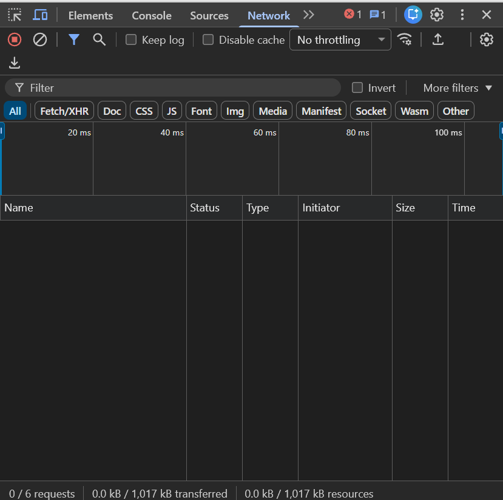
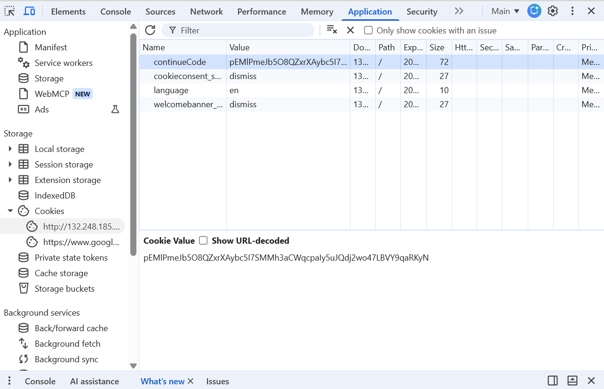
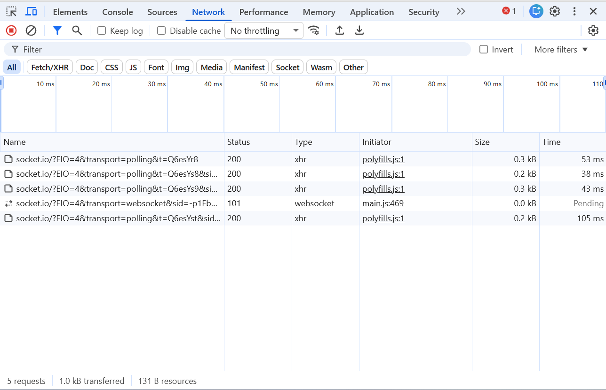
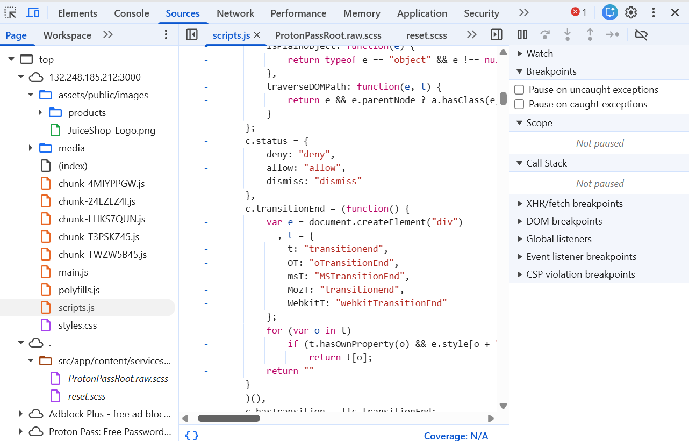
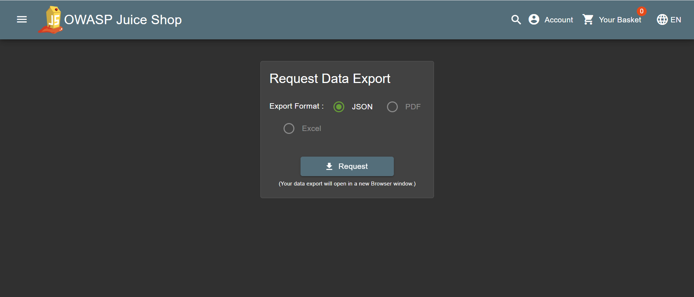

I don't even remember what nmap was for...

```
sudo nmap -sS -F
 -oA sneaky_scan 132.248.185.212
Starting Nmap 7.991 ( https://nmap.org ) at 2026-11-03 08:50 -0600
Nmap scan report for 132.248.185.212
Host is up (0.0051s latency).
Not shown: 94 filtered tcp ports (no-response)
PORT     STATE  SERVICE
21/tcp   closed ftp
113/tcp  closed ident
2000/tcp open   cisco-sccp
3000/tcp open   ppp
5060/tcp open   sip
8888/tcp closed sun-answerbook

Nmap done: 1 IP address (1 host up) scanned in 2.54 seconds
```

Is it enough that I put the plain ip? Don't I need to add a red segment? 

It is interesting that it is scanning the whole red segment, so I believe the professor must have just copied a version of the Juice Shop. Then I think I should just access the specific port

```
Nmap scan report for terra.geociencias.unam.mx (132.248.185.252)
Host is up (0.0063s latency).
Not shown: 93 filtered tcp ports (no-response)
PORT     STATE  SERVICE
25/tcp   closed smtp
113/tcp  closed ident
465/tcp  closed smtps
993/tcp  closed imaps
995/tcp  closed pop3s
2000/tcp open   cisco-sccp
5060/tcp open   sip

Nmap scan report for 132.248.185.254
Host is up (0.0048s latency).
Not shown: 96 filtered tcp ports (no-response)
PORT     STATE  SERVICE
113/tcp  closed ident
179/tcp  open   bgp
2000/tcp open   cisco-sccp
5060/tcp open   sip

Nmap done: 256 IP addresses (90 hosts up) scanned in 28.40 seconds
```

It didn't work the way I expected 

```
sudo nmap -sS -F -oA sneaky_scan 132.248.185.212:3000
Starting Nmap 7.991 ( https://nmap.org ) at 2026-11-03 08:55 -0600
Failed to resolve "132.248.185.212:3000".
WARNING: No targets were specified, so 0 hosts scanned.
Nmap done: 0 IP addresses (0 hosts up) scanned in 4.55 seconds
```

4. I remember the trick of my professor of using ' in order to see if there was the possibility of SQL injection. When I put a ' both in the Email and the Password I got 
```
[object Object]
```
on top of the form

5. So for what I understand there is no point in doing the nmap scans, as I just have one address that interests me. 

6. I don't know if I need to know the OS, but it seems like valuable information

7. Again I got that first of all I need to use sudo, why is that? 
8. Afterwards I got the problem again that I can scan the port

```
sudo nmap -sV -O
 -oA os_scan_3.2 132.248.212:3000
Starting Nmap 7.991 ( https://nmap.org ) at 2026-11-03 09:05 -0600
Failed to resolve "132.248.212:3000".
WARNING: No targets were specified, so 0 hosts scanned.
Nmap done: 0 IP addresses (0 hosts up) scanned in 4.86 seconds

[nixos@nixos:~/repos/cybersecurity/juice_shop]$ sudo nmap -sV -O -oA os_scan_3.2 132.248.212
Starting Nmap 7.991 ( https://nmap.org ) at 2026-11-03 09:05 -0600
Nmap scan report for 132.248.212 (132.248.0.212)
Host is up (0.0034s latency).
Not shown: 990 filtered tcp ports (no-response)
PORT     STATE  SERVICE     VERSION
21/tcp   open   ftp?
25/tcp   open   smtp?
80/tcp   open   http?
110/tcp  open   pop3?
113/tcp  closed ident
143/tcp  open   imap?
443/tcp  open   https?
2000/tcp open   cisco-sccp?
5060/tcp open   sip?
8010/tcp open   xmpp?
Device type: general purpose
Running (JUST GUESSING): Linux 3.X (89%)
OS CPE: cpe:/o:linux:linux_kernel:3
Aggressive OS guesses: Linux 3.2 - 3.8 (89%)
No exact OS matches for host (test conditions non-ideal).

OS and Service detection performed. Please report any incorrect results at https://nmap.org/submit/ .
Nmap done: 1 IP address (1 host up) scanned in 54.23 seconds
```

I assume the reason why it can't guess is that my professor put it in a docker container (which is probably Rocky Linux) but as it didn't went too far (I think to avoid detection) it could not be sure. 

9. How does nmap even know what OS is attacking? What are the telltale signs? 

10. What are profinet devices? 

```
sudo nmap --script safe -oA script_safe_4.1 132.248.212
Starting Nmap 7.991 ( https://nmap.org ) at 2026-11-03 09:10 -0600
No profinet devices in the subnet
```

11. For what I recall the command script safe was used so the requests of nmap would not serve as an unintended DOS. 

12. I don't know what valuable information I can get from this, but I imagine PEAP, EAP-MSCHAP-V2, EAP-TLS, EAP-TTLS are protocols of communication and that one if not all of them might be vulnerable to a network sniffer (a man in the middle)

```
Pre-scan script results:
| targets-asn:
|_  targets-asn.asn is a mandatory parameter
| broadcast-igmp-discovery:
|   172.31.48.1
|     Interface: eth0
|     Version: 2
|     Group: 224.0.0.251
|     Description: mDNS (rfc6762)
|   172.31.48.1
|     Interface: eth0
|     Version: 2
|     Group: 239.255.255.250
|     Description: Organization-Local Scope (rfc2365)
|_  Use the newtargets script-arg to add the results as targets
| eap-info:
| Available authentication methods with identity="anonymous" on interface eth0
|   unknown  PEAP
|   unknown  EAP-MSCHAP-V2
|   unknown  EAP-TLS
|_  unknown  EAP-TTLS
Bug in broadcast-upnp-info: no string output.
|_http-robtex-shared-ns: *TEMPORARILY DISABLED* due to changes in Robtex's API. See https://www.robtex.com/api/
| targets-ipv6-multicast-mld:
|   IP: fe80::9acc:e323:6786:4d15  MAC: 00:15:5d:3a:06:ff  IFACE: eth0
|
|_  Use --script-args=newtargets to add the results as targets
|_hostmap-robtex: *TEMPORARILY DISABLED* due to changes in Robtex's API. See https://www.robtex.com/api/
| targets-sniffer: Sniffed 13 address(es).
| 224.0.0.1
| 239.255.255.253
| 224.0.0.251
| 239.255.255.250
| 224.0.0.9
| fe80::215:5dff:fe55:d4f5
| fe80::9acc:e323:6786:4d15
| 160.79.104.10
| 0.0.0.0
| 224.0.0.13
| 35.190.46.17
| 172.31.48.1
|_224.0.23.12
Stats: 0:03:02 elapsed; 0 hosts completed (1 up), 1 undergoing Script Scan
NSE Timing: About 96.48% done; ETC: 09:13 (0:00:04 remaining)
Stats: 0:03:03 elapsed; 0 hosts completed (1 up), 1 undergoing Script Scan
NSE Timing: About 96.48% done; ETC: 09:13 (0:00:02 remaining)
Stats: 0:03:11 elapsed; 0 hosts completed (1 up), 1 undergoing Script Scan
```

14. What are these things of NSE Timing? My terminal doesn't allow me to put any other command nor to exit, and I don't know if it is actually doing something. 

15. It seems that I can see an error...
```
Failed to load resource: the server responded with a status of 500 (Internal Server Error)
```


I don't actually see anything relevant, just the loading of the necessary componentes for the page to run. 

16. It seems that I messed up with the host and that was probably the reason why Claude Opus 5.5 put me a guardrail. 

17. I didn't knew but we had a guide. On step one it says that "GET http://localhost:3000/rest/user?sort=price:ASC,createdAt:DESC" but where I am supposed to do this? mmm for what I know get is a way in which machines communicate, so if I get 200 OK I assume that means the database is exposed. 

```
sudo nmap --script safe -oA script_safe_4.1 132.248.185.212
Starting Nmap 7.991 ( https://nmap.org ) at 2026-11-03 09:28 -0600
No profinet devices in the subnet
Pre-scan script results:
| targets-asn:
|_  targets-asn.asn is a mandatory parameter
|_http-robtex-shared-ns: *TEMPORARILY DISABLED* due to changes in Robtex's API. See https://www.robtex.com/api/
| targets-ipv6-multicast-mld:
|   IP: fe80::9acc:e323:6786:4d15  MAC: 00:15:5d:3a:06:ff  IFACE: eth0
|
|_  Use --script-args=newtargets to add the results as targets
|_hostmap-robtex: *TEMPORARILY DISABLED* due to changes in Robtex's API. See https://www.robtex.com/api/
Bug in broadcast-upnp-info: no string output.
| targets-sniffer: Sniffed 11 address(es).
| 239.255.255.250
| 224.0.0.9
| 239.255.255.253
| 224.0.0.251
| fe80::215:5dff:fe55:d4f5
| 0.0.0.0
| 160.79.104.10
| fe80::9acc:e323:6786:4d15
| 224.0.0.1
| 224.0.0.13
|_224.0.23.12
| eap-info:
| Available authentication methods with identity="anonymous" on interface eth0
|   unknown  PEAP
|   unknown  EAP-MSCHAP-V2
|   unknown  EAP-TLS
|_  unknown  EAP-TTLS
Nmap scan report for 132.248.185.212
Host is up (0.0041s latency).
Not shown: 994 filtered tcp ports (no-response)
PORT     STATE  SERVICE
21/tcp   closed ftp
113/tcp  closed ident
2000/tcp open   cisco-sccp
3000/tcp open   ppp
5060/tcp open   sip
8888/tcp closed sun-answerbook

Host script results:
|_fcrdns: FAIL (No PTR record)
| dns-zeustracker:
|   Name                                         IP   SBL  ASN  Country  Status  Level    Files Online  Date added
|_  swisssign-check=5vzzpoKf9xfvDXpbfCgSoxCLWCg  nil  nil  nil  nil      nil     Unknown  nil           nil
| unusual-port:
|_  WARNING: this script depends on Nmap's service/version detection (-sV)
|_path-mtu: PMTU == 1280
|_whois-domain: You should provide a domain name.
| asn-query:
| BGP: 132.248.185.0/24 and 132.248.128.0/17 | Country: MX
|   Origin AS: 278 - AS278 - Universidad Nacional Autonoma de Mexico, MX
|_    Peer AS: 17072
Bug in ip-geolocation-geoplugin: no string output.
| port-states:
|   tcp:
|     open: 2000,3000,5060
|     filtered: 1,3-4,6-7,9,13,17,19-20,22-26,30,32-33,37,42-43,49,53,70,79-85,88-90,99-100,106,109-111,119,125,135,139,143-144,146,161,163,179,199,211-212,222,254-256,259,264,280,301,306,311,340,366,389,406-407,416-417,425,427,443-445,458,464-465,481,497,500,512-515,524,541,543-545,548,554-555,563,587,593,616-617,625,631,636,646,648,666-668,683,687,691,700,705,711,714,720,722,726,749,765,777,783,787,800-801,808,843,873,880,888,898,900-903,911-912,981,987,990,992-993,995,999-1002,1007,1009-1011,1021-1100,1102,1104-1108,1110-1114,1117,1119,1121-1124,1126,1130-1132,1137-1138,1141,1145,1147-1149,1151-1152,1154,1163-1166,1169,1174-1175,1183,1185-1187,1192,1198-1199,1201,1213,1216-1218,1233-1234,1236,1244,1247-1248,1259,1271-1272,1277,1287,1296,1300-1301,1309-1311,1322,1328,1334,1352,1417,1433-1434,1443,1455,1461,1494,1500-1501,1503,1521,1524,1533,1556,1580,1583,1594,1600,1641,1658,1666,1687-1688,1700,1717-1721,1723,1755,1761,1782-1783,1801,1805,1812,1839-1840,1862-1864,1875,1900,1914,1935,1947,1971-1972,1974,1984,1998-1999,2001-2010,2013,2020-2022,2030,2033-2035,2038,2040-2043,2045-2049,2065,2068,2099-2100,2103,2105-2107,2111,2119,2121,2126,2135,2144,2160-2161,2170,2179,2190-2191,2196,2200,2222,2251,2260,2288,2301,2323,2366,2381-2383,2393-2394,2399,2401,2492,2500,2522,2525,2557,2601-2602,2604-2605,2607-2608,2638,2701-2702,2710,2717-2718,2725,2800,2809,2811,2869,2875,2909-2910,2920,2967-2968,2998,3001,3003,3005-3006,3011,3017,3030-3031,3052,3071,3077,3128,3168,3211,3221,3260-3261,3268-3269,3283,3300-3301,3306,3322-3325,3333,3351,3367,3369-3372,3389-3390,3404,3476,3493,3517,3527,3546,3551,3580,3659,3689-3690,3703,3737,3766,3784,3800-3801,3809,3814,3826-3828,3851,3869,3871,3878,3880,3889,3905,3914,3918,3920,3945,3971,3986,3995,3998,4000-4006,4045,4111,4125-4126,4129,4224,4242,4279,4321,4343,4443-4446,4449,4550,4567,4662,4848,4899-4900,4998,5000-5004,5009,5030,5033,5050-5051,5054,5061,5080,5087,5100-5102,5120,5190,5200,5214,5221-5222,5225-5226,5269,5280,5298,5357,5405,5414,5431-5432,5440,5500,5510,5544,5550,5555,5560,5566,5631,5633,5666,5678-5679,5718,5730,5800-5802,5810-5811,5815,5822,5825,5850,5859,5862,5877,5900-5904,5906-5907,5910-5911,5915,5922,5925,5950,5952,5959-5963,5985-5989,5998-6007,6009,6025,6059,6100-6101,6106,6112,6123,6129,6156,6346,6389,6502,6510,6543,6547,6565-6567,6580,6646,6666-6669,6689,6692,6699,6779,6788-6789,6792,6839,6881,6901,6969,7000-7002,7004,7007,7019,7025,7070,7100,7103,7106,7200-7201,7402,7435,7443,7496,7512,7625,7627,7676,7741,7777-7778,7800,7911,7920-7921,7937-7938,7999-8002,8007-8011,8021-8022,8031,8042,8045,8080-8090,8093,8099-8100,8180-8181,8192-8194,8200,8222,8254,8290-8292,8300,8333,8383,8400,8402,8443,8500,8600,8649,8651-8652,8654,8701,8800,8873,8899,8994,9000-9003,9009-9011,9040,9050,9071,9080-9081,9090-9091,9099-9103,9110-9111,9200,9207,9220,9290,9415,9418,9485,9500,9502-9503,9535,9575,9593-9595,9618,9666,9876-9878,9898,9900,9917,9929,9943-9944,9968,9998-10004,10009-10010,10012,10024-10025,10082,10180,10215,10243,10566,10616-10617,10621,10626,10628-10629,10778,11110-11111,11967,12000,12174,12265,12345,13456,13722,13782-13783,14000,14238,14441-14442,15000,15002-15004,15660,15742,16000-16001,16012,16016,16018,16080,16113,16992-16993,17877,17988,18040,18101,18988,19101,19283,19315,19350,19780,19801,19842,20000,20005,20031,20221-20222,20828,21571,22939,23502,24444,24800,25734-25735,26214,27000,27352-27353,27355-27356,27715,28201,30000,30718,30951,31038,31337,32768-32785,33354,33899,34571-34573,35500,38292,40193,40911,41511,42510,44176,44442-44443,44501,45100,48080,49152-49161,49163,49165,49167,49175-49176,49400,49999-50003,50006,50300,50389,50500,50636,50800,51103,51493,52673,52822,52848,52869,54045,54328,55055-55056,55555,55600,56737-56738,57294,57797,58080,60020,60443,61532,61900,62078,63331,64623,64680,65000,65129,65389
|_    closed: 21,113,8888
|_ipidseq: Unknown
| dns-blacklist:
|   SPAM
|     all.spamrats.com - FAIL
|     l2.apews.org - SPAM
|     list.quorum.to - SPAM
|   ATTACK
|_    all.bl.blocklist.de - FAIL
| qscan:
| PORT  FAMILY  MEAN (us)  STDDEV   LOSS (%)
| 21    0       5284.30    2128.46  0.0%
| 2000  0       6666.40    5182.13  0.0%
| 3000  0       5759.70    2041.53  0.0%
|_5060  0       5195.50    3163.99  0.0%
| whois-ip: Record found at whois.lacnic.net
| inetnum: 132.248.0.0/16
| owner: Universidad Nacional Autonoma de Mexico
| ownerid: MX-UNAM1-LACNIC
| responsible: Dr. Hector Benitez Perez
|_country: MX

Post-scan script results:
| reverse-index:
|   2000/tcp: 132.248.185.212
|   3000/tcp: 132.248.185.212
|_  5060/tcp: 132.248.185.212
Nmap done: 1 IP address (1 host up) scanned in 117.85 seconds
```
19. It seems I cannot simply use get blindly 
```
GET 132.248.185.212:3000/rest/user?sort=price:ASC,createdAt:DESC
GET: command not found
```

20. I don't know if the "response/preview" sub tab is simply clicking the error message, but I got this 

```
OWASP Juice Shop (Express ^4.22.1)
500 Error: Unexpected path: /rest/user/login
   at /juice-shop/build/routes/angular.js:42:18
   at Layer.handle [as handle_request] (/juice-shop/node_modules/express/lib/router/layer.js:95:5)
   at trim_prefix (/juice-shop/node_modules/express/lib/router/index.js:328:13)
   at /juice-shop/node_modules/express/lib/router/index.js:286:9
   at router.process_params (/juice-shop/node_modules/express/lib/router/index.js:346:12)
   at next (/juice-shop/node_modules/express/lib/router/index.js:280:10)
   at /juice-shop/build/routes/verify.js:208:5
   at Layer.handle [as handle_request] (/juice-shop/node_modules/express/lib/router/layer.js:95:5)
   at trim_prefix (/juice-shop/node_modules/express/lib/router/index.js:328:13)
   at /juice-shop/node_modules/express/lib/router/index.js:286:9
   at router.process_params (/juice-shop/node_modules/express/lib/router/index.js:346:12)
   at next (/juice-shop/node_modules/express/lib/router/index.js:280:10)
   at /juice-shop/build/routes/verify.js:111:5
   at Layer.handle [as handle_request] (/juice-shop/node_modules/express/lib/router/layer.js:95:5)
   at trim_prefix (/juice-shop/node_modules/express/lib/router/index.js:328:13)
   at /juice-shop/node_modules/express/lib/router/index.js:286:9
   at router.process_params (/juice-shop/node_modules/express/lib/router/index.js:346:12)
   at next (/juice-shop/node_modules/express/lib/router/index.js:280:10)
   at logger (/juice-shop/node_modules/morgan/index.js:144:5)
   at Layer.handle [as handle_request] (/juice-shop/node_modules/express/lib/router/layer.js:95:5)
   at trim_prefix (/juice-shop/node_modules/express/lib/router/index.js:328:13)
   at /juice-shop/node_modules/express/lib/router/index.js:286:9
```

in `http://132.248.185.212:3000/rest/user/login`. 

21. For what I understood the GET method was supposed to be executed in the console as it is a http method, but it doesn't work

```
GET http://localhost:3000/rest/user?sort=price:ASC,createdAt:DESC
VM83:1 Uncaught SyntaxError: Unexpected identifier 'http' (at VM83:1:5)
GET http://132.248.185.212:3000/rest/user?sort=price:ASC,createdAt:DESC
VM109:1 Uncaught SyntaxError: Unexpected identifier 'http' (at VM109:1:5)
GET "http://132.248.185.212:3000/rest/user?sort=price:ASC,createdAt:DESC"
VM116:1 Uncaught SyntaxError: Unexpected string (at VM116:1:5)
```

22. When I tried with curl it didn't work either, and while I recognize this is a terminal command when I run it in my terminal I don't get any output either

```
curl -s "http://localhost:3000/rest/user?sort=price:ASC,createdAt:DESC-- -" | head -c 200
VM120:1 Uncaught SyntaxError: Unexpected string (at VM120:1:9)
curl -s "http://132.248.185.212:3000/rest/user?sort=price:ASC,createdAt:DESC-- -" | head -c 200
VM146:1 Uncaught SyntaxError: Unexpected string (at VM146:1:9)
```

23. In the Guia de Estudio it says that I should simply explore the site like a normal person, which makes sense. 

24. The `http://132.248.185.212:3000/#/contact` looks promising, as it is a form. 

25. In `http://132.248.185.212:3000/#/about` there doesn't seem to be anything of use for an attacker, however I didn't know that there was a twitter clone called "Bluesky". 

26. In `http://132.248.185.212:3000/#/photo-wall` there doesn't seem to be anything interesting either. It seems that the juice shop is a whole brand, which is interesting and cute. 

27. In `http://132.248.185.212:3000/#/score-board` it is surprising to me the amount of challenges that the page has. I think that the juice shop can indeed be an extremely good crash course on the red team. 

28. In `http://132.248.185.212:3000/#/search` I assume there is nothing interesting either, as it is simply the products, some of which I assume might be real and can be purchased in a safer place.

29. Now that I have a clearer guide on `Guia-OWASP-Juice-Shop.md` I can look it step by step. 

30. Is `dirsearch` an actual technique? Or is it simply to explore the website manually as I have been doing in the previous steps? 

31. What is `ffuf`? 

32. That `continueCode` cookie seems interesting... but what is a cookie to begin with? I understand them as "cache" memories that the browsers store locally, and I suppose their importance in cybersecurity comes that they allow bot behavior that acts as an actual human visiting the site. 

33. What other subsections could prove interesting? I assume that `Back/forward cache` could be one, `Cache storage` could be another and probably `IndexedDB` as one of the 3 most important ones. 



34. When I clicked `IndexedDB` it appeared that there was "No IndexedDB detected", so I assume it is a larger storage version of `LocalStorage` that probably also supports different data types as times or numeric values, while the former stores everything in strings. 

35. In `Cache storage` I didn't found anything either, as it says "No cache storage detected". 

36. `Back/forward cache` seems to only be a service to see if the connection of the cache is stablished and stored, so it doesn't seem to provide direct information about how to hack the site. It just said to me "Successfully served from back/forward cache
http://132.248.185.212:3000/" 

37. I am still not seeing anything that could serve me. That there is a websocket open seems exciting, as for what I recall websockets are a communication protocol that is practically always run as a daemon, so if I get to vulnerate it I could probably steal data without the owner noticing. 



38. Of the other I have never heard of the `xhr` type. What is that? They also have the name of socket at the beginning, so I assume it is just a different protocol, like TLS. 

39. I knew that you could access code from the browser, but I didn't knew it was this organized 



40. I assume chrome web dev tools automatically changes the names and even messes up the css in order for you to have an idea of how things are organized but that you can't simply copy the code and have a copy of the website. However, as I have seen the trend of Reverse Engineer Anything with binaries I don't see why enough computing power with a powerful AI could not create a replica of the web site... although I imagine the AI would have an easier time simply replicating the site via screeshots. 

41. How could I continue attacking the Juice Shop? I am stuck.

42. How interesting! When I used ` OR 1=1` in the login username I could enter... but where do I look for the users? 

43. When I went to the dev tools I found these errors (which seem to be the same but repeated 4 times)

```
http://132.248.185.212:3000 is not an authorized redirect URI for this application.
main.js:616 Crerror: ProgressEvent {isTrusted: true, lengthComputable: false, loaded: 0, total: 0, type: 'error', …}headers: e {headers: Map(0), normalizedNames: Map(0), lazyInit: undefined, lazyUpdate: null}message: "Http failure response for ./api/Quantitys/: 0 Unknown Error"name: "HttpErrorResponse"ok: falseredirected: undefinedstatus: 0statusText: "Unknown Error"type: undefinedurl: "./api/Quantitys/"[[Prototype]]: Tr
:3000/api/Quantitys/:1  Failed to load resource: net::ERR_CONNECTION_RESET
main.js:484 Crerror: ProgressEvent {isTrusted: true, lengthComputable: false, loaded: 0, total: 0, type: 'error', …}headers: e {headers: Map(0), normalizedNames: Map(0), lazyInit: undefined, lazyUpdate: null}message: "Http failure response for ./rest/basket/1: 0 Unknown Error"name: "HttpErrorResponse"ok: falseredirected: undefinedstatus: 0statusText: "Unknown Error"type: undefinedurl: "./rest/basket/1"[[Prototype]]: Tr
:3000/rest/basket/1:1  Failed to load resource: net::ERR_CONNECTION_RESET
main.js:502 Crerror: ProgressEvent {isTrusted: true, lengthComputable: false, loaded: 0, total: 0, type: 'error', …}headers: e {headers: Map(0), normalizedNames: Map(0), lazyInit: undefined, lazyUpdate: null}message: "Http failure response for ./rest/user/whoami?fields=email: 0 Unknown Error"name: "HttpErrorResponse"ok: falseredirected: undefinedstatus: 0statusText: "Unknown Error"type: undefinedurl: "./rest/user/whoami?fields=email"[[Prototype]]: Tr
:3000/rest/user/whoami?fields=email:1  Failed to load resource: net::ERR_CONNECTION_RESET
main.js:496 Crerror: ProgressEvent {isTrusted: true, lengthComputable: false, loaded: 0, total: 0, type: 'error', …}headers: e {headers: Map(0), normalizedNames: Map(0), lazyInit: undefined, lazyUpdate: null}message: "Http failure response for ./rest/user/whoami: 0 Unknown Error"name: "HttpErrorResponse"ok: falseredirected: undefinedstatus: 0statusText: "Unknown Error"type: undefinedurl: "./rest/user/whoami"[[Prototype]]: Tr
:3000/rest/user/whoami:1  Failed to load resource: net::ERR_CONNECTION_RESET
```

44. I find another place where I think it could be an interesting vulnerability: 



While I cannot download anything for now I assume there must be a way to retrieve all the data of all the users if I manage to trick their own system

45. I was just about to try to mix the `fetch` and `GET` commands on the console when it appeared red letters `[object progressEvent]` on top of "Export Format" just like in the beginning of the login bar. When I went to the dev tools there were a lot of errors such as the previous `Cr` ones along 

```
ERROR Error: Parameter "key" required
    at i.get (chunk-4MIYPPGW.js:1:7579)
    at i.open (chunk-4MIYPPGW.js:18:10673)
    at Object.error (main.js:656:4812)
    at La.error (chunk-LHKS7QUN.js:3:3562)
    at Oe._error (chunk-LHKS7QUN.js:3:3247)
    at Oe.error (chunk-LHKS7QUN.js:3:3007)
    at Ha._error (chunk-LHKS7QUN.js:3:5843)
    at Ha.error (chunk-LHKS7QUN.js:3:3007)
    at Ha._error (chunk-LHKS7QUN.js:3:3247)
    at Ha.error (chunk-LHKS7QUN.js:3:3007)
```

and 

```
Failed to load resource: net::ERR_CONNECTION_RESET
:3000/rest/user/data-export:1  Failed to load resource: net::ERR_CONNECTION_RESET
:3000/rest/user/data-export:1  Failed to load resource: net::ERR_CONNECTION_RESET
```

at the end. 

46. I ran the `fetch` method and got more errors, but I don't know which valuable information they bring 

```
fetch('http://host:3000/rest/user?...').then(r => r.json()).then(console.log)
M {__zone_symbol__state: null, __zone_symbol__value: Array(0)}__zone_symbol__state: 0__zone_symbol__value: TypeError: Failed to fetch
    at http://132.248.185.212:3000/polyfills.js:2:3143
    at e.<computed> (http://132.248.185.212:3000/polyfills.js:1:14181)
    at <anonymous>:1:1Symbol(Symbol.species): (...)Symbol(Symbol.toStringTag): (...)[[Prototype]]: Object
polyfills.js:2  GET http://host:3000/rest/user?... net::ERR_NAME_NOT_RESOLVED
(anonymous) @ polyfills.js:2
e.<computed> @ polyfills.js:1
(anonymous) @ VM209:1
polyfills.js:1 TypeError: Failed to fetch
    at polyfills.js:2:3143
    at e.<computed> (polyfills.js:1:14181)
    at <anonymous>:1:1
```

While `polyfills` could be unnecessary leakage of information, I think it is most likely just a generic, random name for a web-related action. 

47. Is it okay that I put `host` or do I need to replace it with `http://132.248.185.212/`? Lets give it a try 

```
fetch('http://132.248.185.212:3000/rest/user?...').then(r => r.json()).then(console.log)
M {__zone_symbol__state: null, __zone_symbol__value: Array(0)}__zone_symbol__state: 0__zone_symbol__value: SyntaxError: Unexpected token '<', "<html>
  <"... is not valid JSONSymbol(Symbol.species): (...)Symbol(Symbol.toStringTag): (...)[[Prototype]]: Object
polyfills.js:2  GET http://132.248.185.212:3000/rest/user?... 500 (Internal Server Error)
(anonymous) @ polyfills.js:2
e.<computed> @ polyfills.js:1
(anonymous) @ VM231:1
polyfills.js:1 SyntaxError: Unexpected token '<', "<html>
  <"... is not valid JSON (at VM232:1:1)
```

It seems it didn't change anything... the error message looks shorter though. 

48. I tried to run the curl script without the `-s` flag so it isn't silent but somehow I wrote something wrongly 

```
curl -i "http://132.248.185.212:3000/rest/user?sort=price:ASC,createdAt:DESC-- -" | h
ead -c 200
curl: (3) URL rejected: Malformed input to a URL function
```

