# My report

I do have docker installed in my NixOS machine

```
 docker --version
Docker version 29.6.2, build v29.6.2
```

```
docker pull bkimminich/juice-shop
```

And I got 

```
Digest: sha256:adaf6a6ca50f772dff7d2fe56972c659e81a61e0dbbe607c2b39fefd436e6153
Status: Downloaded newer image for bkimminich/juice-shop:latest
docker.io/bkimminich/juice-shop:latest
```

```
docker run \--rm \-p 127.0.0.1:3000:3000 bkimminich/juice-shop
```

Now it works and I have it open in localhost

```
info: Server listening on port 3000
```

Now I need to install nuclei, which I should just put in my flake.nix if I am not mistaken. 

Everything seems to be working well

```
 nuclei -update-templates

                     __     _
   ____  __  _______/ /__  (_)
  / __ \/ / / / ___/ / _ \/ /
 / / / / /_/ / /__/ /  __/ /
/_/ /_/\__,_/\___/_/\___/_/   v3.11.1

                projectdiscovery.io

[INF] nuclei-templates are not installed, installing...
[INF] Successfully installed nuclei-templates at /home/nixos/nuclei-templates
[INF] No new updates found for nuclei templates
```

What are the relevant templates I need to have? 

I am checking at a guide some years ago and I found this

```
 nuclei -t https://example.com -t ~/nuclei-templates/

                     __     _
   ____  __  _______/ /__  (_)
  / __ \/ / / / ___/ / _ \/ /
 / / / / /_/ / /__/ /  __/ /
/_/ /_/\__,_/\___/_/\___/_/   v3.11.1

                projectdiscovery.io

[FTL] Could not run nuclei: Could not create loader.: Remote template URL host (example.com) is not present in the `remote-template-domain` list in nuclei config
```

So at least that command doesn't work

I ran 

```
nuclei -u https://127.0.0.1:3000 -t ~/nuclei-templates/
```

and its taking quite some time, so I assume it is working. 

There are a lot of templates to choose from, and indeed it seems I download them all

```
cd ~/nuclei-templates/
direnv: unloading

[nixos@nixos:~/nuclei-templates]$ ls
cloud                   network
code                    profiles
CODE_OF_CONDUCT.md      PULL_REQUEST_TEMPLATE.md
CONTRIBUTING.md         README_CN.md
contributors.json       README_JA.md
cves.json               README_KR.md
cves.json-checksum.txt  ssl
dast                    TEMPLATE-CREATION-GUIDE.md
dns                     TEMPLATE-REVIEW-GUIDE.md
file                    templates-checksum.txt
headless                TEMPLATES-STATS.json
helpers                 TEMPLATES-STATS.md
http                    TOP-10.md
javascript              websocket
LICENSE.md              workflows
```

For what it seems I am scanning with all the templates instead of the relevant ones... that was a mistake. 

I don't know where I got lost but I was waiting for the command to stop running when it had a long time ago 

```
nuclei -u https://127.0.0.1:3000 -t ~/nuclei-templates/

                     __     _
   ____  __  _______/ /__  (_)
  / __ \/ / / / ___/ / _ \/ /
 / / / / /_/ / /__/ /  __/ /
/_/ /_/\__,_/\___/_/\___/_/   v3.11.1

                projectdiscovery.io

[INF] Current nuclei version: v3.11.1 (latest)
[INF] Current nuclei-templates version: v10.5.2 (latest)
[INF] New templates added in latest release: 121
[INF] Templates loaded for current scan: 11330
[INF] Executing 11330 signed templates from projectdiscovery/nuclei-templates
[INF] Targets loaded for current scan: 1
[INF] Templates clustered: 2737 (Reduced 2602 Requests)
[INF] Skipped 127.0.0.1:5814 from target list as found unresponsive permanently: Get "https://127.0.0.1:5814/autopass": cause="port closed or filtered" address=127.0.0.1:5814 chain="connection refused"
[INF] Skipped 127.0.0.1:4040 from target list as found unresponsive permanently: cause="port closed or filtered" address=127.0.0.1:4040 chain="connection refused; got err while executing https://127.0.0.1:4040/jobs/"
[INF] Scan completed in 7m. 0 matches found.
[INF] HTTP connections: 4 total, 3 new, 1 reused (25.0%)
```

I did it again... but this should be a mistake, doesn't it? the juice shop is full of vulnerabilities and it found none 

```
nuclei -u http:127.0.0.1:3000

                     __     _
   ____  __  _______/ /__  (_)
  / __ \/ / / / ___/ / _ \/ /
 / / / / /_/ / /__/ /  __/ /
/_/ /_/\__,_/\___/_/\___/_/   v3.11.1

                projectdiscovery.io

[INF] Current nuclei version: v3.11.1 (latest)
[INF] Current nuclei-templates version: v10.5.2 (latest)
[INF] New templates added in latest release: 121
[INF] Templates loaded for current scan: 11330
[INF] Executing 11330 signed templates from projectdiscovery/nuclei-templates
[INF] Targets loaded for current scan: 1
[INF] Running httpx on input host
[INF] Found 0 URL from httpx
[INF] Templates clustered: 2737 (Reduced 2602 Requests)
[INF] Scan completed in 26.494100109s. No results found.
```

Indeed I just need to use the folders that will most likely help me, so coming back to the templates I have 

```
[nixos@nixos:~/nuclei-templates]$ ls
cloud                   network
code                    profiles
CODE_OF_CONDUCT.md      PULL_REQUEST_TEMPLATE.md
CONTRIBUTING.md         README_CN.md
contributors.json       README_JA.md
cves.json               README_KR.md
cves.json-checksum.txt  ssl
dast                    TEMPLATE-CREATION-GUIDE.md
dns                     TEMPLATE-REVIEW-GUIDE.md
file                    templates-checksum.txt
headless                TEMPLATES-STATS.json
helpers                 TEMPLATES-STATS.md
http                    TOP-10.md
javascript              websocket
LICENSE.md              workflows
```

The ones that seem the most relevant are dns, headless, websocket. 

The professor says that `-jsonl` is to save it in JSONL and with `-o` I gave the file the name. 

The categories that seem to be the most relevant are the ones that run with this scan

```
nuclei -u http://127.0.0.1:3000 -pt http \
  -tags exposure,misconfig,headers,tech \
  -etags intrusive,default-login \
  -s info,low,medium,high \
  -ni -rl 10 -c 5 \
  -jle nuclei_juice.jsonl -me nuclei_md
```

What does the `-pt` flag mean? I understand that it only runs http but what `-pt` stands for? 

I assume the `jle` and `me` mean something like "JSONL extend" and "Markdown extend", so we can have just one file that grows through time instead of being constantly replaced. 

It went through! 

```
nuclei -u http://127.0.0.1:3000 -pt http \
  -tags exposure,misconfig,headers,tech \
  -etags intrusive,default-login \
  -s info,low,medium,high \
  -ni -rl 10 -c 5 \
  -jle nuclei_juice.jsonl -me nuclei_md

                     __     _
   ____  __  _______/ /__  (_)
  / __ \/ / / / ___/ / _ \/ /
 / / / / /_/ / /__/ /  __/ /
/_/ /_/\__,_/\___/_/\___/_/   v3.11.1

                projectdiscovery.io

[INF] Current nuclei version: v3.11.1 (latest)
[INF] Current nuclei-templates version: v10.5.2 (latest)
[INF] New templates added in latest release: 121
[INF] Templates loaded for current scan: 3021
[INF] Executing 3021 signed templates from projectdiscovery/nuclei-templates
[INF] Targets loaded for current scan: 1
[INF] Templates clustered: 1199 (Reduced 1137 Requests)
[swagger-api] [http] [info] http://127.0.0.1:3000/api-docs/swagger.json [paths="/api-docs/swagger.json"]
[http-missing-security-headers:content-security-policy] [http] [info] http://127.0.0.1:3000
[http-missing-security-headers:permissions-policy] [http] [info] http://127.0.0.1:3000
[http-missing-security-headers:x-permitted-cross-domain-policies] [http] [info] http://127.0.0.1:3000
[http-missing-security-headers:referrer-policy] [http] [info] http://127.0.0.1:3000
[http-missing-security-headers:cross-origin-embedder-policy] [http] [info] http://127.0.0.1:3000
[http-missing-security-headers:cross-origin-opener-policy] [http] [info] http://127.0.0.1:3000
[http-missing-security-headers:cross-origin-resource-policy] [http] [info] http://127.0.0.1:3000
[http-missing-security-headers:strict-transport-security] [http] [info] http://127.0.0.1:3000
[INF] Skipped 127.0.0.1:5814 from target list as found unresponsive permanently: Get "https://127.0.0.1:5814/autopass": cause="port closed or filtered" address=127.0.0.1:5814 chain="connection refused"
[prometheus-metrics] [http] [medium] http://127.0.0.1:3000/metrics
[fingerprinthub-web-fingerprints:qm-system] [http] [info] http://127.0.0.1:3000
[tech-detect:google-font-api] [http] [info] http://127.0.0.1:3000
[deprecated-feature-policy] [http] [info] http://127.0.0.1:3000 ["payment 'self'"]
[owasp-juice-shop-detect] [http] [info] http://127.0.0.1:3000
[INF] Scan completed in 9m. 14 matches found.
[INF] HTTP connections: 5107 total, 1582 new, 3525 reused (69.0%)
```

But I don't see the `nuclei_juice.jsonl` or `nuclei_md` files anywhere. 

It seems that I have done everything that was required in this first part

I need to install `zaproxy` so back to the `flake.nix` file. 

It didn't work, that probably isn't the name

```
nix-direnv: /home/nixos/repos/cybersecurity/flake.nix
error:
       … while calling the 'derivationStrict' builtin
         at «nix-internal»/derivation-internal.nix:37:12:
           36|
           37|   strict = derivationStrict drvAttrs;
             |            ^
           38|

       … while evaluating derivation 'nix-shell'
         whose name attribute is located at «github:NixOS/nixpkgs/dc5d91f840324650bac8c379428c7037a416959a?narHash=sha256-VaWGJ6%2BcIYN2erfSecbRV%2B4ljI185Ty2wUrXyvQbgOw%3D»/pkgs/stdenv/generic/make-derivation.nix:651:11

       … while evaluating attribute 'nativeBuildInputs' of derivation 'nix-shell'
         at «github:NixOS/nixpkgs/dc5d91f840324650bac8c379428c7037a416959a?narHash=sha256-VaWGJ6%2BcIYN2erfSecbRV%2B4ljI185Ty2wUrXyvQbgOw%3D»/pkgs/stdenv/generic/make-derivation.nix:719:11:
          718|           depsBuildBuild = buildBuildOutputs;
          719|           nativeBuildInputs = buildHostOutputs;
             |           ^
          720|           depsBuildTarget = buildTargetOutputs;

       (stack trace truncated; use '--show-trace' to show the full, detailed trace)

       error: undefined variable 'zaproxy'
       at /home/nixos/repos/cybersecurity/flake.nix:12:11:
           11|           nuclei
           12|           zaproxy
             |           ^
           13|           unzip
```

With zap I am struggling a lot in finding the tools that Claude tells me, I have version 2.17, the latest, and I went to tools > client spider and selected the following 


It doesn't allow me to run, as it says I need a valid starting point along with the protocol

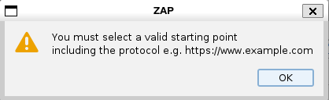

I think the problem is that I am not putting the complete address 

Now it works, and it seems it went through everything fairly quickly, which is suspicious for me as my computer is not that powerful. Maybe AJAX will require more power

I went through


but it is telling me that 


What is the scope in this scenario? I will uncheck that mark for now 

Now it is working

IT seems it broke somewhere along the way, could this be by the poor hardware power of my machine? 

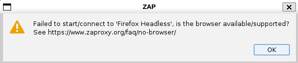

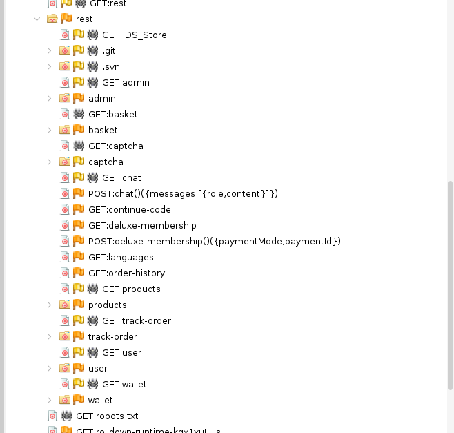

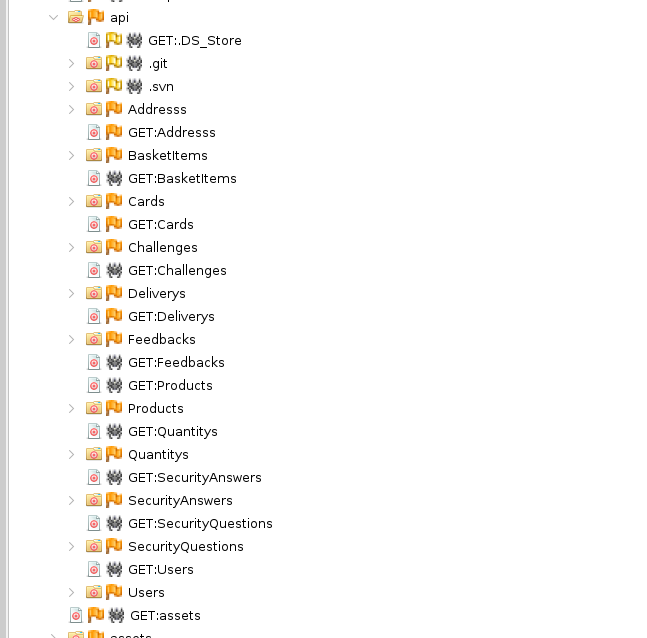

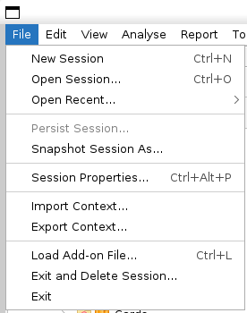

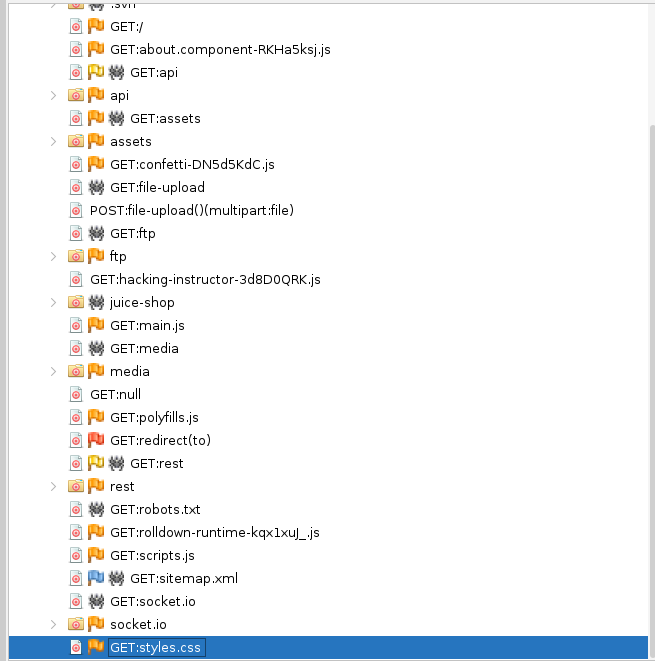

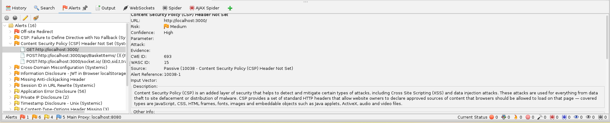

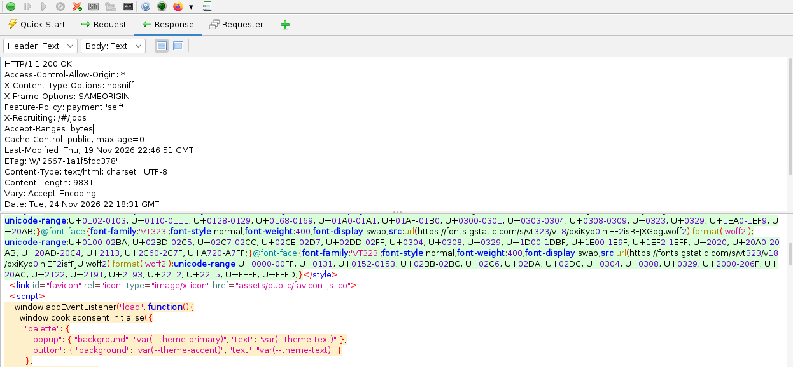

For what I understand all of these were simply mistakes of negligence by the programmers rather than a complex strange condition that opened a vulnerability. The CSP I think it should be just like any other HTML tag that you write in order to have that header. 

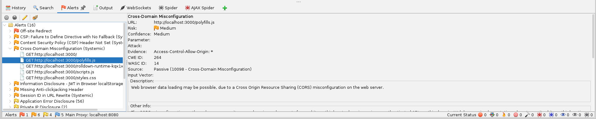

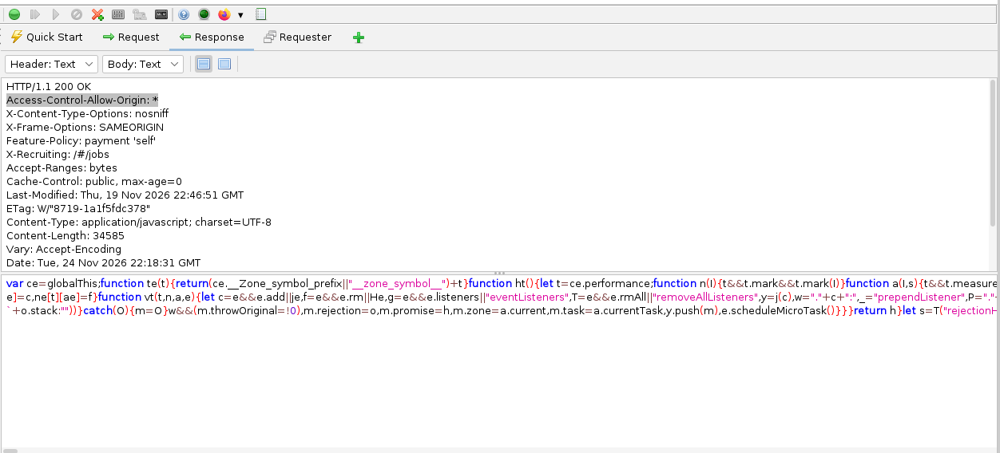

I don't understand why the AI told me to check on `GET /rest/products/search?q=` as that seems more like an HTTP request rather than a file I can click. Check `m2_passive_cors_alert.png` to see that doesn't appear. 

I think the problem with this is that we allow every site to have a response from us (the juice shop) so I believe anyone can request private data and if we don't have guard rails for it we might just send it directly. 

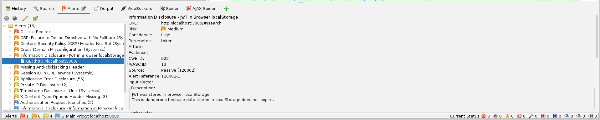

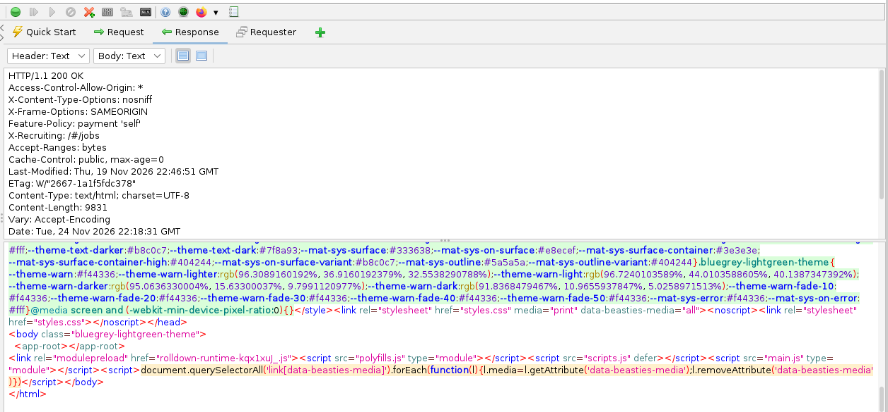

This problem is that by putting the JWT in localStorage (which is simply an array of strings that anyone can access in the browser) then we are giving anyone the opportunity to supplant the identity of the person who that cookie belongs to, allowing access in its account. 

What does the colors state in the response? I see there are some which are highlighted in green and others in yellow. 

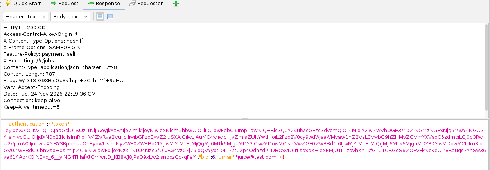

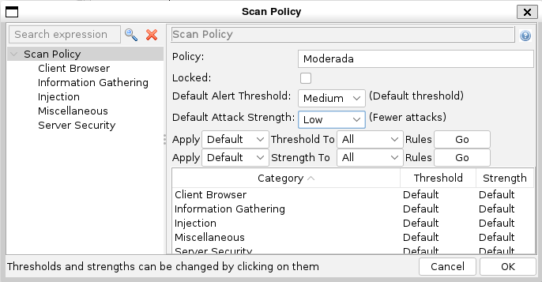

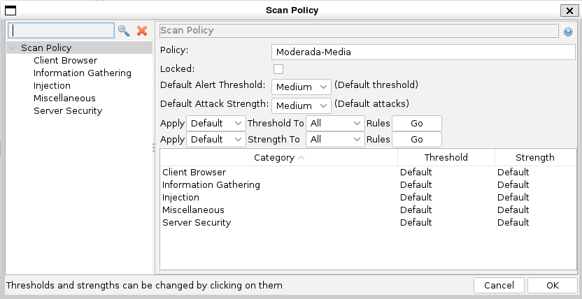

In products I have that what we sent is 

```
GET http://localhost:3000/rest/products/search?q=%27%28 HTTP/1.1
Host: localhost:3000
User-Agent: Mozilla/5.0 (X11; Linux x86_64; rv:155.0) Gecko/20100101 Firefox/155.0
Accept: application/json, text/plain, */*
Accept-Language: en-US,en;q=0.9
Referer: http://localhost:3000/
Authorization: Bearer eyJ.<JWT-SCRUBBED>
Connection: keep-alive
Cookie: language=en; welcomebanner_status=dismiss; cookieconsent_status=dismiss; token=eyJ.<JWT-SCRUBBED>; continueCode=8PVgMZE4p6L8NXYxJwoQ2vqjnG77cLCVS7QGKa3O71brWD5yzRBemkPl9VXW
Sec-Fetch-Dest: empty
Sec-Fetch-Mode: cors
Sec-Fetch-Site: same-origin
Priority: u=0
```

Responding 1: What ZAP sent and what came back
I don't see what is actually being sent, I assume it is `GET http://localhost:3000/rest/products/search?q=%27%28 HTTP/1.1` so I think it is sending `q=2728` and that `%` are probably a type of separator. 

What it sent back is a JSON that shows us that there is an error in the SQL

```
{
  "error": {
    "message": "SQLITE_ERROR: near \"(\": syntax error",
    "stack": "Error: SQLITE_ERROR: near \"(\": syntax error",
    "errno": 1,
    "code": "SQLITE_ERROR",
    "sql": "SELECT * FROM Products WHERE ((name LIKE '%'(%' OR description LIKE '%'(%') AND deletedAt IS NULL) ORDER BY name"
  }
}
```

2. Why that response suggests SQL injection.
Because as it is checking the open parenthesis as an error of SQLite that probably means it is parsing whatever we enter directly, without safeguards, so we might put a query directly in there in order to retrieve data. 

3. Why ZAP's confidence is only Low.
Because we have only found the error, we haven't go all the way to insert a payload that actually breaks into the database. 

Is there a way to put ZAP in night mode? Its white background, small text and icons is really forcing my sight to work hard.  

Much better with the change in aspect. 

```
{
  "error": {
    "message": "SQLITE_ERROR: unrecognized token: \"value\"",
    "stack": "Error\n    at Database.<anonymous> (/juice-shop/node_modules/sequelize/lib/dialects/sqlite/query.js:185:27)\n    at /juice-shop/node_modules/sequelize/lib/dialects/sqlite/query.js:183:50\n    at new Promise (<anonymous>)\n    at Query.run (/juice-shop/node_modules/sequelize/lib/dialects/sqlite/query.js:183:12)\n    at /juice-shop/node_modules/sequelize/lib/sequelize.js:315:28\n    at process.processTicksAndRejections (node:internal/process/task_queues:104:5)",
    "name": "SequelizeDatabaseError",
    "parent": {
      "errno": 1,
      "code": "SQLITE_ERROR",
      "sql": "SELECT * FROM Users WHERE email = ''' AND password = 'value' AND deletedAt IS NULL"
    },
    "original": {
      "errno": 1,
      "code": "SQLITE_ERROR",
      "sql": "SELECT * FROM Users WHERE email = ''' AND password = 'value' AND deletedAt IS NULL"
    },
    "sql": "SELECT * FROM Users WHERE email = ''' AND password = 'value' AND deletedAt IS NULL",
    "parameters": {}
  }
}
```

It seems that in order to paste the email there are two single quotes waiting for it, as we put another one we get a third and SQL fails because there are no complete pairs of symbols. I replaced the actual hash with 'value' in order to not expose the password I put

